<div align="center">


# Hirely.ai

**Turn a job description into a scored shortlist and a hire.**<br>
Résumé matching, AI voice interviews with live proctoring, coding assessments, offers and performance reviews, in one multi-tenant app.

<a href="https://github.com/sufiinamulhassan/AI-HR-Automation-System/stargazers"></a>
<a href="https://github.com/sufiinamulhassan/AI-HR-Automation-System/fork"></a>
<a href="LICENSE"></a>
<a href="https://github.com/sufiinamulhassan/AI-HR-Automation-System/commits/main"></a>
<a href="https://hits.sh/github.com/sufiinamulhassan/AI-HR-Automation-System/"></a>

<br><br>

<a href="#tech-stack"></a>
<a href="#tech-stack"></a>
<a href="#tech-stack"></a>
<a href="#tech-stack"></a>
<a href="#tech-stack"></a>
<br>
<a href="#tech-stack"></a>
<a href="#tech-stack"></a>
<a href="#tech-stack"></a>
<a href="#tech-stack"></a>
<a href="#tech-stack"></a>
<a href="#tech-stack"></a>

<br><br>

<a href="#quick-start">Quick start</a> &nbsp;•&nbsp;
<a href="#what-computer-do-you-need">Requirements</a> &nbsp;•&nbsp;
<a href="#from-a-job-description-to-a-hire">Job to hire</a> &nbsp;•&nbsp;
<a href="#features">Features</a> &nbsp;•&nbsp;
<a href="#how-it-works">How it works</a> &nbsp;•&nbsp;
<a href="#multi-tenancy-and-the-platform-console">Multi-tenancy</a> &nbsp;•&nbsp;
<a href="#careers-page">Careers page</a> &nbsp;•&nbsp;
<a href="#using-the-app">Using the app</a> &nbsp;•&nbsp;
<a href="#tech-stack">Tech stack</a> &nbsp;•&nbsp;
<a href="#questions-and-tips">Questions</a> &nbsp;•&nbsp;
<a href="#contributors">Contributors</a> &nbsp;•&nbsp;
<a href="#add-your-code">Contribute</a>

<br><br>

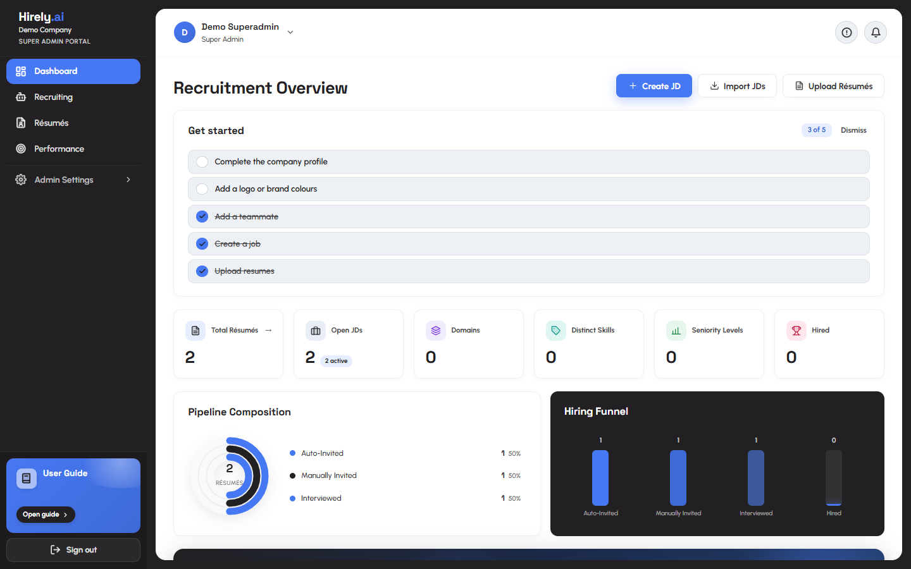

</div>

<br>

> [!NOTE]
> Hirely.ai takes you from a job description and a pile of résumés to a ranked shortlist, an AI voice interview with live proctoring and a scored report, and then an offer. It is multi-tenant: one deployment serves many companies, each an isolated workspace with its own users, roles, branding, mail, sign-in and AI settings, run from an operator console at `/platform`. Open jobs can also be published on a public careers page at `/careers`, where candidates apply by uploading a résumé that goes straight to the company that owns the job.

## Quick start

Pick the way that suits you. Each one ends at the same app.

| | Local machine | Demo mode | Vercel |
|---|---|---|---|
| **Best for** | Development, and trying it with your own jobs and résumés | A one minute tour with no accounts to create | A hosted deployment for real users |
| **You need** | Python 3.11+, Node.js 18+, MongoDB, an [OpenAI API key](https://platform.openai.com/api-keys) | The local setup, with `DEBUG=true` and `ALLOW_DEMO_AUTH=true` | A [Vercel](https://vercel.com) account, a [MongoDB Atlas](https://www.mongodb.com/atlas) cluster, an OpenAI key |
| **Start** | `uvicorn main:app --reload` and `npm run dev` | Press **Enter Client Demo** or **Enter Platform Demo** on the login page | `vercel --prod` |

> [!IMPORTANT]
> **Already have a database from before multi-tenancy?** The first backend start against it runs a one-time, idempotent migration that stamps `company_id` on every existing row, so everything you had becomes the Default company. Create a backup first and preview the changes with `python scripts/migrate_multitenant.py` from `backend/`. See [Migrating an existing database](#migrating-an-existing-database).

### Run it on your machine

1. **Clone the project.**

   ```bash
   git clone https://github.com/sufiinamulhassan/AI-HR-Automation-System.git
   cd AI-HR-Automation-System
   ```

2. **Start MongoDB.** Use Docker, a local MongoDB Community install, or a free Atlas cluster and copy its SRV connection string.

   ```bash
   docker run -d -p 27017:27017 --name hirely-mongo mongo:7
   ```

3. **Install the backend.** Use `requirements-dev.txt` locally. It includes `requirements.txt` plus the test tools, and `requirements.txt` on its own is the deployable set.

   ```bash
   cd backend
   python -m venv venv
   venv/Scripts/pip install -r requirements-dev.txt     # macOS and Linux: venv/bin/pip
   ```

4. **Configure it.** Copy the example file, then open `.env` and fill in the minimum.

   ```bash
   cp .env.example .env
   ```

   ```dotenv
   MONGODB_URI=mongodb://localhost:27017
   OPENAI_API_KEY=sk-...
   SECRET_KEY=<32+ random characters>
   SECRETS_ENCRYPTION_KEY=<another 32+ random characters>
   DEFAULT_SUPERADMIN_EMAIL=you@example.com
   DEFAULT_SUPERADMIN_PASSWORD=<12+ chars, not a common password>
   FRONTEND_URL=http://localhost:5173
   ```

   Generate each key with:

   ```bash
   python -c "import secrets; print(secrets.token_hex(32))"
   ```

   Default models are OpenAI (`gpt-4o`, `gpt-4o-mini`, `text-embedding-3-small`), so an OpenAI key alone is enough. `SECRETS_ENCRYPTION_KEY` encrypts the credentials companies store (SMTP, SSO, integrations). If you leave it unset, a key is derived from `SECRET_KEY`, so rotating `SECRET_KEY` would then make stored company secrets unreadable. For vector matching, also set `PINECONE_API_KEY` and `PINECONE_INDEX_NAME`, and create the index with **dimension 1536**.

5. **Start the API.**

   ```bash
   venv/Scripts/python -m uvicorn main:app --reload     # macOS and Linux: venv/bin/python
   ```

   | URL | What |
   |---|---|
   | http://localhost:8000 | API root |
   | http://localhost:8000/api/docs | Swagger UI, only when `DEBUG=true` or `EXPOSE_API_DOCS=true` |
   | http://localhost:8000/api/redoc | ReDoc, same condition |
   | http://localhost:8000/health | Liveness probe |
   | http://localhost:8000/health/ready | Readiness probe, answers 503 when MongoDB is unreachable |

6. **Start the app.** In a second terminal:

   ```bash
   cd frontend
   npm install
   npm run dev
   ```

   The UI opens on **http://localhost:5173**. `npm run dev` first runs `scripts/setup-mediapipe.mjs`, which vendors about 15 MB of MediaPipe proctoring assets into `public/`, so the interview page never depends on a third party CDN at runtime. In development the app calls the API at `VITE_API_BASE_URL`, which defaults to `http://localhost:8000`. If your backend runs on another port, put the URL in `frontend/.env.local`:

   ```dotenv
   VITE_API_BASE_URL=http://localhost:8001
   ```

7. **Sign in.** Open `/login` and use the `DEFAULT_SUPERADMIN_EMAIL` and `DEFAULT_SUPERADMIN_PASSWORD` from your `.env`. Platform owners sign in at `/login` like anyone else and land on `/platform`.
   - **On a fresh database** you land on the platform console. Owners use the console only, so create a client there with its first company and administrator (**Clients > New client**). That administrator signs in at `/login?company=<slug>` and gets the recruiting UI. Without a mail server, set their password when you create them.
   - **On a migrated database** your existing users sign in as before. The account matching `DEFAULT_SUPERADMIN_EMAIL` becomes a platform owner and lands on `/platform`.

> [!NOTE]
> The app refuses to boot with the shipped `SECRET_KEY`, or with no `DEFAULT_SUPERADMIN_PASSWORD`, unless `DEBUG=true`. Read the startup log: `validate_runtime_config()` prints one line per capability it had to disable, such as no email transport, no Pinecone or no LLM key. Those lines are the only warning you get before a feature silently does nothing.

### Try it in demo mode

The login page has two demo buttons that sign in with no password. **Enter Client Demo** opens the recruiting workspace as a Super Admin of the Default company, or of a real company you name (see [Show a real company in the demo](#show-a-real-company-in-the-demo)). **Enter Platform Demo** opens the platform console as a platform owner.

1. In `backend/.env`, set `DEBUG=true`, `ALLOW_DEMO_AUTH=true` and `HACKATHON_DEMO_MODE=true`, then restart the API.
2. Optionally add sample data. Both scripts write into the Default company. Set `SEED_COMPANY_ID=<company_id>` in the shell to seed a company you created in the console instead.

   ```bash
   cd backend
   venv/Scripts/python scripts/seed_production_data.py    # macOS and Linux: venv/bin/python
   venv/Scripts/python scripts/seed_user_guides.py        # fills the in-app User Guide
   ```

3. Open `/login` and press **Enter Client Demo** for the workspace view or **Enter Platform Demo** for the console view. Sign out to switch from one to the other.

- `ALLOW_DEMO_AUTH` lets the API accept demo tokens. **The app refuses to boot with it on unless `DEBUG=true`**, so `DEBUG` only is the safe combination.
- `HACKATHON_DEMO_MODE` makes destructive calls from demo accounts simulated: deletes, purges, decisions, sends and the like return success and nothing is written.
- The login page shows an error if the API rejects the demo sign-in, and it names both settings.
- The platform demo uses the bearer token `demo-platform-token`, which the API accepts under `DEBUG` only. `demo-<role>-token@@<company_id>` signs in to a specific company, also under `DEBUG` only.
- **Never enable any of this on a real deployment.**

> [!TIP]
> The screenshots in [Using the app](#using-the-app) were taken in demo mode, so you will see the same screens a minute after you start.

#### Show a real company in the demo

To let an evaluator look around a company you built in the platform console, without being able to change it, set `DEMO_COMPANY_ID` in `backend/.env` to that company's id and restart the API. A company's id is the last part of its page address in the console, `/platform/companies/<company_id>`, and looks like `cmp_0123456789ab`.

- **Enter Client Demo** then opens that company, with its own name, branding, jobs, résumés, candidates and settings, instead of the Default company. A `@@<company_id>` suffix on a demo token is ignored, so the demo cannot be pointed at any other company.
- **Nothing can be changed.** Every demo request that is not a read (`POST`, `PUT`, `PATCH` and `DELETE`) is answered with `Demo mode: this action was simulated and nothing was changed.` and the handler never runs. Signing in and password reset requests are the only exceptions, so a leftover demo token cannot stop a real sign in. This covers **Enter Platform Demo** too. The app shows the same message in a small notice at the bottom of the screen.
- If the company does not exist, demo requests answer 503 with `The demo company is not available`, rather than showing another company.
- Leave `DEMO_COMPANY_ID` empty to go back to the Default company, where only the destructive calls listed above are simulated.
- The evaluator reads what the company holds, including real candidate details. **Enter Platform Demo** shows the whole platform console, including the contact inbox and the owner list. Keep both for private demos, and never switch demo sign in on for a public site.

### Deploy it on Vercel

One project serves both halves. The Vite build is the static site, and `api/index.py` runs the FastAPI app as a Python function. `vercel.json` rewrites `/api/*` and `/health` to it, and everything else to `index.html` for the SPA router. Both sit on one domain, so the browser never makes a cross origin request. There is **no CORS to configure and no API URL to set**.

```bash
npm i -g vercel
vercel          # the first run links the project
vercel --prod
```

Or import the repository at [vercel.com](https://vercel.com), where `vercel.json` is picked up automatically. Leave the framework preset as **Other**, because the build command and output directory are already specified. Set the environment variables below **before the first deploy**, under Project > Settings > Environment Variables.

<details>
<summary>Environment variables for Vercel</summary>

| Variable | Why |
|---|---|
| `MONGODB_URI` and `MONGODB_DB` | Atlas SRV string and database name. Serverless egress IPs are not stable, so the cluster's network access list must allow `0.0.0.0/0`. |
| `OPENAI_API_KEY` | Parsing, matching, interviews. Enough on its own, since the default models are OpenAI. |
| `SECRET_KEY` | JWT signing. Refuses to boot on the default unless `DEBUG=true`. |
| `SECRETS_ENCRYPTION_KEY` | Encrypts company stored credentials. Set it separately from `SECRET_KEY`, and keep it, because losing it makes those secrets unreadable. |
| `CRON_SECRET` | Authorizes the daily scheduled jobs. Without it they are disabled. |
| `DEFAULT_SUPERADMIN_EMAIL` and `DEFAULT_SUPERADMIN_PASSWORD` | Seeded on first connect as a platform owner, your first sign in. |
| `FRONTEND_URL` | `https://<your-project>.vercel.app`. A wrong value sends real emails whose links go nowhere. |
| `STRICT_SECURITY_VALIDATION` | Set to `true` on a real deploy. |
| `PINECONE_API_KEY` | Optional. Without it matching is disabled. |
| `ANTHROPIC_API_KEY` | Optional. Adds Claude models to the model picker. |
| `EMAIL_*` | Optional. Without SMTP, invites are generated but never sent. Companies can bring their own. |
| `STRIPE_*` | Optional. Enables Stripe checkout and the customer portal in the console. |
| `PLATFORM_ALERT_EMAILS` | Optional. Extra recipients for operator alerts. |

**Do not set `VITE_API_BASE_URL`.** Leaving it unset is what makes the frontend call its own origin. Leave `ALLOW_DEMO_AUTH` off, because it refuses to boot without `DEBUG`.

</details>

**Existing database: migrate first.** If `MONGODB_URI` points at a database that existed before multi-tenancy, the first request to the new deployment runs the one-time migration. It is idempotent, but take a backup and preview it before you deploy. For a large database, apply it with the script first so a 60 second function never has to do the work. `backend/scripts` is excluded from the Vercel bundle, so run the script from your own machine with the production values in `backend/.env`. The commands are in [Migrating an existing database](#migrating-an-existing-database).

**Scheduled jobs.** `vercel.json` declares one cron, `GET /api/v1/cron/daily` at `0 8 * * *` (08:00 UTC). Vercel sends `Authorization: Bearer <CRON_SECRET>` when the variable is set, which is why the variable matters. The run walks every active company within a 55 second budget: invite reminders, interview reminders for other platforms, job source sync and data retention, then the platform checks (storage, trials, failed email). Each job also has its own endpoint (`/cron/reminders`, `/cron/external-reminders`, `/cron/job-sync`, `/cron/retention`), and `GET /api/v1/cron/status` shows the last run of each to an admin.

**Custom domains.** To serve a company on its own domain, add the domain to the Vercel project, set its DNS, then list it on the company in the console.

<details>
<summary>What serverless changes</summary>

Worth knowing before you rely on it, rather than after:

- **Request bodies cap around 4.5 MB.** Bulk upload accepts 500 files, but a batch over that ceiling is rejected by the platform before FastAPI sees it. Upload in smaller batches.
- **`maxDuration` is 60 s**, the Hobby ceiling. Raise it in `vercel.json` on a paid plan. Background tasks such as résumé processing and JD parse and match run inside the request, so a large batch can be cut off mid flight.
- **Fire and forget audit writes may be dropped.** `asyncio.create_task(...)` is not awaited and the function can freeze once the response is sent. That is fine for audit logs, but not for anything a user is waiting on.
- **The in-process scheduler does not run.** `start_scheduler()` detects the serverless host and does nothing. The daily Vercel cron replaces it, so scheduled work runs once a day rather than every few hours. On a host with a long lived process the scheduler runs the job source sync (every `JOB_IMPORT_SYNC_INTERVAL_HOURS`) and invite reminders (daily) on its own, needs no `CRON_SECRET`, and the other jobs can be driven by calling their `/api/v1/cron/*` endpoints.
- **Nothing may be written to local disk** or held in module level state between requests. `config/database.py` is the one deliberate exception, a cached connection guarded by `_initialized`.
- **Cold starts.** The first request after idle opens a fresh MongoDB connection. `api/index.py` handles that lazily, so it is slow rather than broken.

If those constraints do not suit the workload, the backend is an ordinary uvicorn app. Run `backend/` on any host with a long lived process and point `VITE_API_BASE_URL` at it.

</details>

## What computer do you need

Hirely.ai runs on an ordinary laptop or desktop. It is a web app with a database behind it, and the heavy AI work happens at the provider, not on your machine.

| | Works | Comfortable |
|---|---|---|
| **System** | Windows, macOS or Linux with Python 3.11 or newer | The same, with Python 3.14, which is what the project is developed and tested on |
| **Node.js** | 18 | 20 or newer |
| **Database** | A local MongoDB (Docker is the easiest) or a free Atlas cluster | An Atlas cluster, so there is nothing to run locally |
| **Memory and processor** | No tested minimum | A recent laptop with 8 GB or more, so MongoDB, the API, Vite and a browser fit together |
| **Graphics card** | Not needed | Not needed, because every AI call runs at the provider |
| **Internet** | Needed for OpenAI, for `npm install`, for the first `npm run dev` (it downloads the proctoring models), and for Pinecone and email if you use them | The same |
| **Browser** | A current Chrome. Candidates need camera and microphone access, and a secure origin (https or localhost) | The same |
| **Optional services** | None. Without Pinecone matching is off, without SMTP emails are generated but not sent, without a sandbox provider code cannot run | Pinecone, an SMTP server or AWS SES, and Judge0 or Piston for coding assessments |

**The numbers behind the table**

- **Python and Node.js:** the backend asks for Python 3.11+ and is developed and tested on 3.14. The frontend asks for Node.js 18+, with 20+ recommended.
- **Proctoring assets:** about 15 MB of MediaPipe files land in `frontend/public/` through `npm run setup:mediapipe`, which `npm run dev` and `npm run build` trigger. The WASM runtime is copied from `node_modules`, and the two detection models are downloaded once from Google storage and skipped afterwards. They are gitignored, not committed.
- **Résumé batches:** up to 500 files per batch (`MAX_BULK_UPLOAD_FILES`). On Vercel a request body caps around 4.5 MB, so upload in smaller batches there.
- **Vectors:** 1536 dimensions. A Pinecone index must be created with that dimension to match `text-embedding-3-small`.
- **Interview defaults:** 30 minutes, 15 questions, and a candidate link that stays valid for 7 days.
- **Not measured:** memory and CPU use have not been benchmarked, so the Works column is a floor for the software, not a tested limit.

## From a job description to a hire

This is the path a recruiter follows, from an empty company to a signed offer.

1. **Sign in.** Open `/login`, or `/login?company=<slug>` for a company's own page with its branding and single sign-on button.
2. **Add a job.** In **Recruiting**, press **Create JD** to write one, or **Import JDs** to pull from Remotive, Arbeitnow, RemoteOK, The Muse or Jobicy. LinkedIn and Indeed work when `LINKEDIN_API_KEY` or `INDEED_API_KEY` is set. The description is parsed into structured targeting criteria and embedded.
3. **Publish it (optional).** A job you write is shown on the public careers page at `/careers` by default, and an imported job is not. Tick or untick **Show on the careers page** in the job form, and copy the job's public link from **Job Details**. See [Careers page](#careers-page).
4. **Upload résumés, or let candidates apply.** Press **Upload Résumés** and drop up to 500 PDF or Word files. Each one is text extracted, classified, embedded, deduplicated by content hash, matched and scored. Candidates can also apply themselves on the job's public page by uploading a résumé (PDF, DOC, DOCX or TXT, up to 4 MB). That résumé goes through the same steps and lands in the job's pipeline tagged **Career page**.
5. **Review the pipeline.** Matches above the similarity threshold (0.35 by default) appear under **Candidate Pipeline** with a score. Filter by stage, drag the minimum match score, compare candidates side by side and open an AI fit snapshot.
6. **Invite.** A recruiter invites from the pipeline, or with `AUTO_INVITE_ENABLED=true` anything at or above 0.70 is invited with no human involved. The candidate receives an email with a private link and no scores.
7. **The candidate interviews.** The link opens `/interview/:token`. The AI asks, the candidate speaks, the answer is transcribed and confirmed back, and proctoring runs in the browser. A coding assessment can follow at `/coding/:token`.
8. **Read the report.** A scored report covers technical competency, communication, problem solving and cultural fit, with a hire, maybe or reject recommendation and any integrity concerns. Share it with a hiring manager as a read only link, or send a human interviewer a scorecard link.
9. **Make an offer.** Generate an offer with an AI drafted letter, send it for token linked acceptance at `/offer/:token`, and push hired candidates to an external HRMS through a webhook.
10. **Review performance later.** Existing employees go through review cycles with self, manager, peer and skip level reviews.

The diagrams under [How it works](#how-it-works) show the whole path, and [Using the app](#using-the-app) walks through each screen.

## Features

| | |
|---|---|
| **Job descriptions that parse themselves** | Write or import a JD. It becomes structured criteria, a vector, and a match against the résumé pool, so a job posted today finds candidates uploaded last month. |
| **Résumé limits and low match cleanup** | A JD can stop at a maximum number of résumés. Once it is full, matching stops adding to it and its careers page says no more candidates are accepted. After sourcing, HR removes the résumés below a minimum match score, either from that JD only or from the whole system. |
| **Bulk résumé intake** | Up to 500 résumés per batch, with text extraction, classification, content hash deduplication, matching and scoring. A **Résumés** page holds the whole pool with filters, an in page viewer, bulk delete and a **JDs** button that lists every job a résumé is in with its score. |
| **A public careers site** | `/careers` lists every open, public job of every active company, with search and filters. Each job has its own page with the full description and an apply form. A candidate uploads a résumé (PDF, DOC, DOCX or TXT, up to 4 MB), and it goes only to the company that owns the job, scored and added to that job's pipeline tagged **Career page**. |
| **Two thresholds, one review step** | `0.35` decides what a recruiter sees. `0.70` decides what the system acts on without a human, once auto invite is on. The gap between them is the review step. |
| **AI voice interviews** | A token linked interview. The AI asks, the candidate speaks, and each answer is transcribed and confirmed back to them. |
| **Live proctoring** | MediaPipe runs in the browser. Tab switches, focus loss and face presence anomalies are recorded with timestamps and fed into the evaluator's prompt. |
| **Scored reports** | Technical competency, communication, problem solving and cultural fit, a hire, maybe or reject recommendation and integrity concerns. PDF export is admin only. |
| **Reports for other people** | Read only report links for hiring managers (expiry of 1 to 30 days, revocable, with feedback) and scorecard links for human interviewers, no account needed. |
| **External and in person interviews** | Record an interview held on Zoom, Google Meet, Teams, another platform or on site. Send a calendar invite, get reminders and capture a review. |
| **Coding assessments** | An in browser workspace. Code runs server side through Judge0 or Piston, with paste blocking, keystroke counting and plagiarism similarity checking. Recruiters can watch live sessions, and a question bank is kept per company. |
| **Offers and analytics** | AI drafted letters, company letterhead, signatures and a PDF, token linked acceptance and an HRMS webhook push for hires. One dashboard call aggregates pipeline metrics, and each sub metric fails independently so one bad aggregation never blanks the page. |
| **Sourcing and comparison** | Boolean search strings (strict, balanced, broad) generated from a JD for external sites, side by side candidate comparison and interview guides for human interviewers. |
| **A needs attention queue** | A menu in the top bar surfaces what is stuck: invites nobody opened, interviews starting soon, offers with no response and failed emails. |
| **Performance reviews** | Cycles scoped to the organization, a department or a job grade, with self, manager, peer and skip level reviews and configurable rating dimensions. |
| **HRMS** | Employees, leave, attendance and holidays after the hire. A directory with offboarding, leave types with yearly allowances that count working days only, a daily attendance sheet with a monthly summary, and a company holiday calendar. Accepted offers become employees automatically. |
| **People insights** | **Hire quality** puts the résumé match and AI interview score of everyone hired through Hirely next to their performance and attendance, and says in plain words whether interview scores predict performance. A **flight risk and burnout radar** lists the reasons behind every score. A **coverage guard** warns before approving leave that would leave a team under half strength. All of it is computed from your own data, with no AI calls. |
| **Data governance** | Erase a candidate from every store, including vectors, and keep an anonymised tombstone. Set retention periods and a daily job erases what has aged out. |
| **Many companies, one deployment** | Each company is an isolated workspace with its own logins, roles, branding, mail, sign-in, webhooks, audit log and AI spend. An operator console at `/platform` covers clients, usage per feature, AI spend, billing statements with optional Stripe, health and platform owner accounts. |
| **Sign in your way** | Password, an emailed one-time code, an authenticator app with recovery codes, Google, or a company's own OpenID Connect provider. |
| **Models by job** | OpenAI by default, with Claude as an option. A company can route each AI job (interview, hiring, coding) to its own model, and every call lands in a per company cost ledger. |
| **Everything configurable** | Roles and a permission matrix, departments and grades, email templates, webhooks, workflow rules, security policies, branding and notification settings. |

## How it works

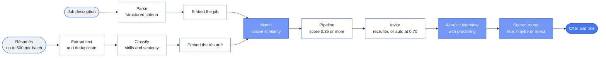

### From a résumé to an invited candidate

1. **Upload** through `POST /api/v1/intel/resumes/upload-bulk`, or `POST /api/v1/resumes/upload` for one file.
2. **Extract** text with `pdfplumber`, `python-docx` and `olefile` (for old Word `.doc` files). Parsing is CPU bound, so it runs in an executor rather than blocking the event loop.
3. **Deduplicate** by content hash, which rejects a file already ingested.
4. **Classify** with `RESUME_CLASSIFICATION_MODEL` to extract skills, seniority and domain, plus the latest job title, location and recent employers that the Résumés filters use. A role is then worked out from those by rules, never by the model.
5. **Embed** with `RESUME_EMBEDDING_MODEL` to produce a 1536 dimension vector, upserted to Pinecone.
6. **Match** by cosine similarity against every stored job vector, with a seniority flex window and a higher bar for cross domain matches.
7. **Store or act.** Above `RESUME_SIMILARITY_THRESHOLD` the match is stored and appears in the pipeline. With `AUTO_INVITE_ENABLED=true`, at or above `AUTO_INVITE_THRESHOLD` an invite is sent automatically. Otherwise a recruiter invites from the pipeline.

A job description follows the same road in the other direction. `POST /api/v1/jobs` (or an import from a job board) parses it into targeting criteria, embeds it, and matches it **backwards** against the existing résumé pool, so a job posted today finds candidates uploaded last month. Parsing and matching run as a FastAPI background task, so the request returns immediately, and every admin started AI action (upload, import, rematch) is checked against the company's plan budget first.

A candidate can also start the road themselves. `POST /api/v1/careers/jobs/{job_id}/apply` takes a résumé from the public careers page and runs the same extract, classify, embed and match steps, then attaches the résumé to that job's pipeline. The apply flow is drawn under [Careers page](#careers-page).

The interview has four beats. Questions are **prepared** from the JD and the candidate's résumé. In the **live turn loop** text to speech asks, the candidate speaks, the audio is transcribed and confirmed back to them, and the next question adapts. **Proctoring** flags tab switches, focus loss and face anomalies with timestamps. Then the transcript and the integrity flags go to the **evaluator**, which produces per dimension scores and a hire, maybe or reject recommendation.

### From a job description to a hire, step by step

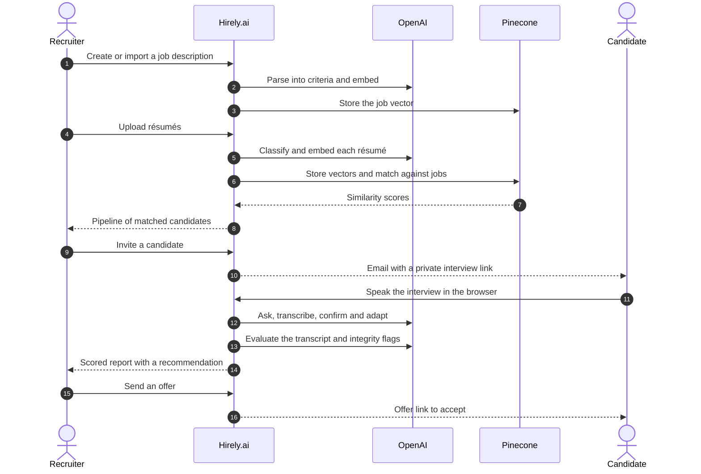

## Multi-tenancy and the platform console

One deployment serves many customers.

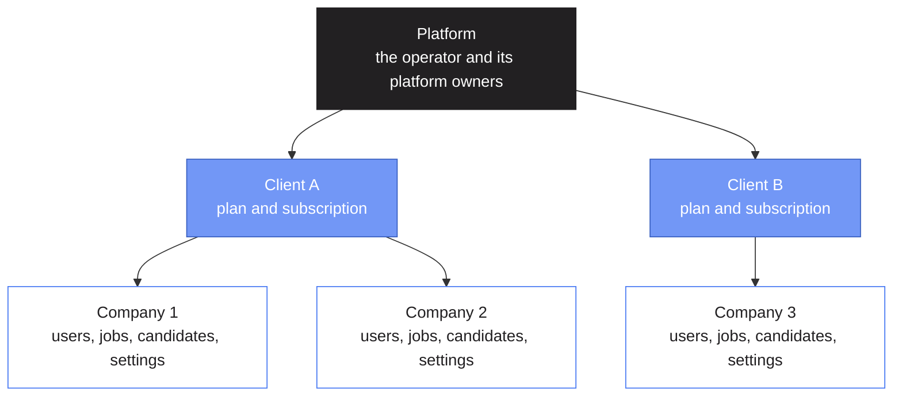

- A **company** can never read or write another company's data. A **client** is not a data boundary. It exists so the operator can see and manage a customer as one unit and hold its plan and subscription.
- Each company has its **own logins**. An email belongs to exactly one company across the whole platform, and nobody switches company. Role names are per company: `standard`, `admin`, `superadmin` and that company's custom roles. `superadmin` means "top administrator of this company", not "platform owner".
- **Platform owners** (`users.is_platform_admin`) run the console. It shows counts and spend only, never candidate, résumé, interview or report content. `DEFAULT_SUPERADMIN_EMAIL` is a platform owner.
- Two fixed workspaces exist: **Platform** (`cmp_platform`, hosts owner accounts) and **Default** (`cmp_default`, what a database created before multi-tenancy becomes).

<details>
<summary>How isolation is enforced</summary>

`config/tenancy.py` is the whole mechanism.

- `get_db()` returns a handle bound to the current company. It adds `company_id` to every filter, stamps it on every insert, and prepends a `$match` to every aggregation. `$lookup`, `$unionWith`, `$graphLookup`, `$merge`, `$out` and any method the wrapper does not list are refused, so a new driver call cannot slip past the scope.
- `get_platform_db()` is the raw database, for platform code only. The `clients`, `companies` and `settings` collections cannot be reached through `get_db()`.
- The company comes from the signed-in account, from the document a public token link names (interview, offer, review, share and interviewer links), or from a per company loop in scheduled jobs. With nothing bound, `get_db()` raises rather than guess, so it fails closed.
- Unique indexes on human chosen keys are `(company_id, field)`. Vectors in Pinecone carry a `company_id` and queries filter on it.
- Per company settings live on the company record and are read with `company_setting()`. The process wide `settings` object is shared by every company on a warm instance and is never mutated per request.

</details>

<details>
<summary>Plans and limits</summary>

Each client has a plan. `null` means unlimited, and a missing feature flag means on.

| Part of a plan | What it does |
|---|---|
| `max_companies`, `max_users_per_company` | Seat limits, answered with HTTP 409 when exceeded |
| `monthly_ai_budget_usd` | At the limit, admin started AI actions answer 402. Anything a candidate does through a public link is never blocked, so a budget cannot stop an interview in progress. The one exception is a new application on the [careers page](#careers-page), which answers 503 "not accepting applications right now" |
| `max_storage_mb` | Uploads answer 413 when full. A new careers page application answers 503 instead |
| `features` | Switches for `coding`, `performance`, `webhooks`, `workflows`, `custom_smtp`, `oidc_sso`, `custom_domain` and `integrations`. A switched off feature answers 402 on its admin routes |
| `price_monthly_usd`, `trial_ends_at` | Feed billing statements. An ended trial or a cancelled subscription blocks sign-in with a plain message |

Presets: `standard` (everything on, no limits, the default), `starter`, `growth` and `enterprise`. A per company hourly allowance on AI actions (HTTP 429) stops one company from starving the shared deployment.

</details>

### The platform console

Platform owners sign in at `/login` like anyone else and land on `/platform`.

| Page | What it shows |
|---|---|
| **Overview** | Totals, growth over 12 months, top clients, recent platform audit rows |
| **Clients** | Create a client with its first company and administrator, edit the plan, suspend, activate, delete. A company page adds administrators, password resets, custom domains, the AI models it runs, suspension and offboarding |
| **Inbox** | Messages sent from the public contact page. Filter by status and topic, search, set a status (new, in progress, done, spam), add an internal note, or delete a message. Every change is in the platform audit log |
| **Usage** | A matrix of client by feature (jobs, résumés, candidates, interviews, coding, offers, performance, emails, AI calls) for 7, 30 or 90 days or a calendar month |
| **AI models** | Which model every company runs and through which platform key. Keys are shown as a variable name and a mask, never the value |
| **Billing** | A monthly statement per client with CSV export, manual subscription status, and optional Stripe checkout and customer portal |
| **Health** | MongoDB latency, mail and Pinecone configuration, the last run of every scheduled job, failed emails per company |
| **Audit** | Every platform write |
| **Platform owners** | Add and deactivate. The last active owner cannot be deactivated |

Owners are emailed when a scheduled job fails, a company reaches 80% and 100% of its AI budget or 90% of its storage, a trial is about to end, or a Stripe payment fails. Extra recipients go in `PLATFORM_ALERT_EMAILS`. Deleting a company needs it to be suspended first and its slug typed to confirm. It removes the company's rows and vectors and resumes across calls if it runs out of time.

### Giving a company its sign-in link

Open the company in the console and copy its sign-in link, `/login?company=<slug>`. That page shows the company's branding and its single sign-on button. A company can also use its own web address: the owner lists the hostnames on the company page (plan feature `custom_domain`), a request whose host matches resolves to that company for branding and sign-in, and every link the system emails for that company uses the domain instead of `FRONTEND_URL`. Adding the domain to the Vercel project, its DNS and TLS, and registering the OAuth redirect URI are yours to do.

### What each company configures itself

Under the Organization and Platform Settings pages: branding, its own SMTP server, OpenID Connect single sign-on (Okta, Microsoft Entra, Google Workspace, Auth0 or any OpenID provider, with PKCE, optional enforcement and new accounts only from email domains the owner assigned), HRMS, Zoom and Teams credentials, security policies, retention, terms and privacy links, and its AI models. Environment values for HRMS, Zoom and Teams apply to the Default company only, so a company never uses someone else's account.

<details>
<summary>How company secrets are kept</summary>

Anything a company hands the system (SMTP password, SSO client secret, HRMS, Zoom and Teams tokens, authenticator secrets) is encrypted at rest with `SECRETS_ENCRYPTION_KEY` and is write only through the API, which returns a flag such as `has_password` instead. If the key is unset one is derived from `SECRET_KEY`, so set it separately in production. To rotate it, move the old value to `SECRETS_ENCRYPTION_KEY_PREVIOUS`. Every request to a URL a company chose (webhook, HRMS, SSO discovery) goes through `shared/safe_http.py`, which refuses private addresses, pins the validated IP, never follows redirects and caps the response.

</details>

### Migrating an existing database

The first backend start against a database that existed before multi-tenancy runs a one-time, idempotent migration (`config/tenancy_migration.py`). It creates the Platform and Default workspaces and stamps `company_id` on every existing row, so everything you had becomes the Default company. It runs again as a no-op on every later start.

Point `MONGODB_URI` and `MONGODB_DB` at the database first. `.env.example` shows `MONGODB_DB=hirely`, so keep your current name if it differs. Then take a backup, preview the changes and apply:

```bash
cd backend
venv/Scripts/python scripts/migrate_multitenant.py            # report only, changes nothing
venv/Scripts/python scripts/migrate_multitenant.py --apply    # run the migration now
```

The report lists the rows without a company per collection, and without `--apply` it changes nothing. You do not have to run `--apply` yourself, because the same migration runs automatically at the first server start. Use `--apply` to run it ahead of time, for example before a Vercel deploy. It then re-checks and exits non zero if any row is still unstamped. The script uses `MONGODB_URI` and `MONGODB_DB` from `backend/.env`, and it is not shipped to Vercel, so run it from your machine with the production values.

Vectors already in Pinecone carry no company tag. They keep matching for the Default company (`MATCH_UNTAGGED_FOR_DEFAULT` in `services/hr_module/vector_scope.py`), so nothing breaks. To tag them, run the backfill. It is a dry run unless you pass `--apply`, and `--company` picks the owner (default `cmp_default`):

```bash
venv/Scripts/python scripts/backfill_pinecone_company.py
venv/Scripts/python scripts/backfill_pinecone_company.py --apply
```

## Careers page

A public site that needs no account. `/careers` lists every open, public job of every active company, with search and filters for company, location, employment type and remote work, plus pagination. `/careers/:jobId` is the page of one job, with its full description and an apply form. A company admin decides which jobs appear, and an application goes only to the company that owns the job.

**Which jobs are shown.** A job appears only when all three rules hold.

| Rule | What it means |
|---|---|
| **Public** | `jobs.is_public` is true. A job created by hand is public by default and an imported job is not. A hand made job from before the field existed, with no `is_public` value, counts as public. |
| **Still open** | The job has no deadline, or its deadline is in the future. |
| **Active company** | The company is active, its client is not suspended, its trial or subscription has not ended, and it is not the Platform workspace. |

Company admins switch a job on or off with the **Show on the careers page** checkbox in the job form. **Job Details** then shows a **Careers page** block with the public link, a **Copy** button and **Open page**.

**Résumé limit.** A job with **Max résumés** set stays listed once its pipeline is full, but its page shows **No more candidates accepted** in place of the apply form, its card carries the same tag, and an application is refused with 409. Removing low matches frees places again.

**Why it opens quickly.** The page uses the same header and footer as the home page, so moving to it redraws only the middle. The server keeps the job list, the filters and the company index in memory for `CAREERS_CACHE_SECONDS` and sends `Cache-Control: public, max-age=30, stale-while-revalidate=60`. The browser fetches the page code and the first page of jobs when you point at the **Careers** link, and while it is idle. When you change a filter the current jobs stay on screen, and placeholders appear only if the answer takes longer than about a second.

**What a visitor sees.** A safe public view only: title, a short summary, location, employment type, remote flag, up to 6 skills, posting and closing dates, and the company name and logo. The job page adds the full description and the company's website, privacy and terms links when set. Salary, internal fields and company ids are never returned.

**What happens when someone applies.**

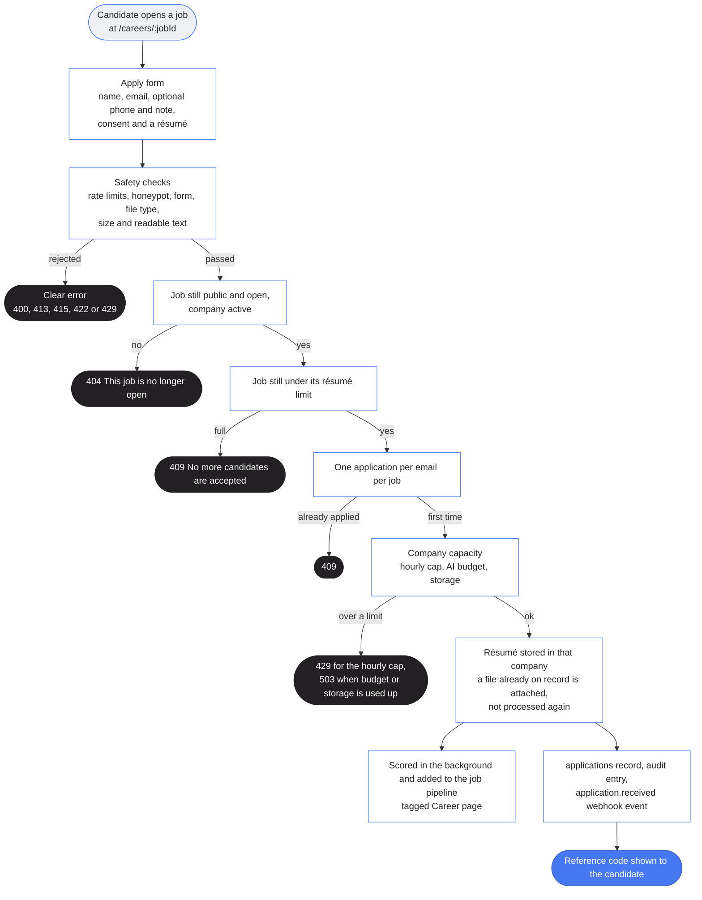

1. **Fill in the form.** Name, email, an optional phone number and note (up to 2,000 characters), a consent checkbox and a résumé file.
2. **Pass the checks.** The file must be a PDF, DOC, DOCX or TXT of at most `CAREERS_MAX_RESUME_MB` (4 MB by default), its content must match its type, and it must contain readable text. A scan with no text layer, or a password protected Word file, is refused up front with HTTP 422, so nobody gets a confirmation for a file the system cannot read.
3. **Land in the right company.** The résumé is stored in the job's company, scored against that job and added to its candidate pipeline tagged **Career page**. If the identical file is already on record it is attached to the job without processing it again. A career applicant is scored against the job they applied for and is never hidden by the **Min match score** slider.
4. **Leave a trail.** An `applications` record is written, an audit entry is added and an `application.received` webhook event is emitted. The candidate sees a reference code on screen. **No email is sent to the candidate from the careers page.**

<details>
<summary>Safety limits on the public API</summary>

| Protection | Detail |
|---|---|
| **Rate limits** | Reads: 240 requests per minute per IP. Applying: 12 per hour per IP and 300 per hour per job. Over a limit answers 429. |
| **Company wide cap** | `CAREERS_APPLICATIONS_PER_HOUR` (default 120) applications per company per hour, answered with 429. |
| **Plan limits** | A company over its AI budget or storage limit answers 503 "not accepting applications right now", and the candidate is told to try later. |
| **Honeypot** | A hidden `website` field. A bot that fills it gets a normal looking reply and nothing is stored. |
| **Input checks** | Name (2 to 120 characters), a valid email, an optional phone number, consent required, and the file type, size and content checks above. |
| **One application per email per job** | A second attempt answers 409. The email is compared in lowercase. |
| **Caching** | Read responses carry `Cache-Control: public, max-age=30, stale-while-revalidate=60`, so a visibility change shows within about a minute. |

An application is deleted together with its person or résumé: erasing a candidate, deleting a résumé, or retention purging a résumé all remove it.

</details>

## The public website

The product has a public face that needs no account: a home page, a features page, integrations, comparisons, an ROI calculator, a FAQ, candidate help, a trust center, pricing, security and responsible AI pages, a contact form, the careers pages and eight legal documents. They share one header, footer and look. Every page sets its own title, description and canonical address, and an address that matches nothing shows a real 404 page.

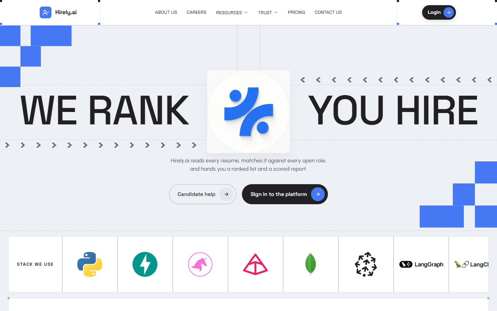

**The header** has six items in this order: **About Us**, **Careers**, **Resources** (a menu), **Trust** (a menu), **Pricing** and **Contact Us**, with one **Login** button on the right. On a phone the same items sit in a drawer. The menus open on hover, click or keyboard, close on Escape or a click outside, and warm the next page while you point at a link. **Resources** holds Features, Integrations, Compare, ROI calculator, FAQ and Candidate help. **Trust** holds Security, Responsible AI, the trust center and every legal document.

**Every page except the home page opens with the same plain hero**: a small label, a title with an accent line, and one line of text. A hero has no buttons, links or breadcrumbs, and a test checks that for every public path. Calls to action sit at the end of each page.

| Path | Page |
|---|---|
| `/` | Home |
| `/about` | What Hirely.ai is, how it is built and who is responsible for data |
| `/features` | What the product does by area, with a feature by plan table |
| `/integrations` and six pages under it | Zoom, Microsoft Teams, HR systems, single sign-on, webhooks and email delivery, each written from what the code does |
| `/compare` and three pages under it | Comparisons with manual screening, a traditional ATS and one-way video interviews. They compare approaches, never named products, and say when the other approach is the better fit |
| `/roi-calculator` | Plain arithmetic on the visitor's own numbers, with no prediction |
| `/faq` | About 34 answers in six groups |
| `/candidates` | What to expect from an AI interview or coding assessment |
| `/trust` | Security, privacy and AI commitments, and every document |
| `/pricing` | The plans, read live from the backend |
| `/security` | Controls, data isolation, what we have not published, and how to report a vulnerability |
| `/responsible-ai` | Where AI is used, who decides, and what customers control |
| `/contact` | A contact form |
| `/careers`, `/careers/:jobId` | The public job list and one job. See [Careers page](#careers-page) |
| `/terms`, `/privacy`, `/candidate-privacy`, `/cookies`, `/acceptable-use`, `/dpa`, `/subprocessors`, `/accessibility` | The legal documents |

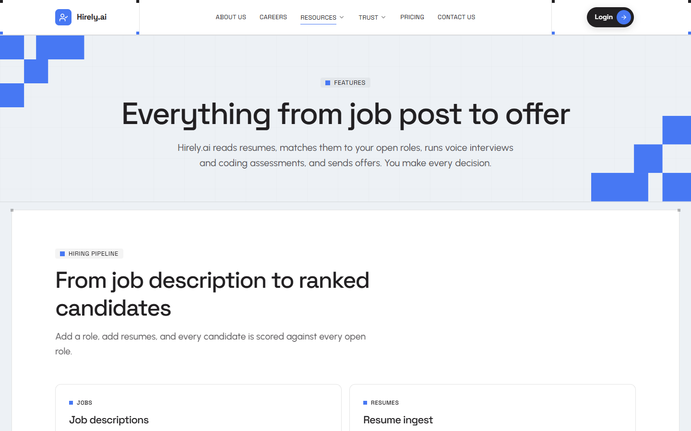

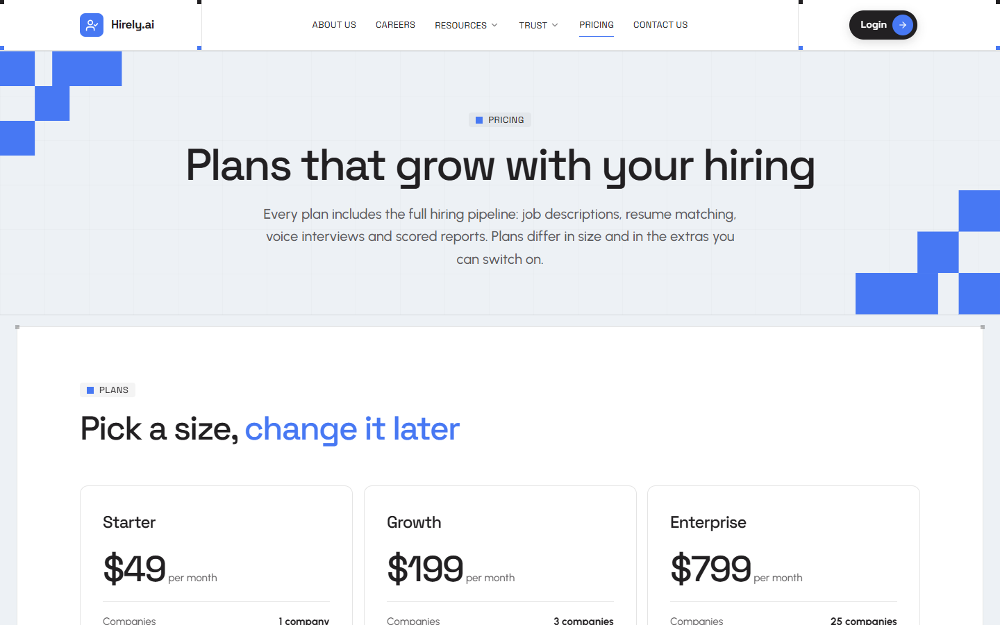

**How the pages are built.** `frontend/src/components/site` holds the shared pieces: the layout, header, footer, hero, cards, steps and call to action band. Long text is data. Integrations, comparisons, the FAQ, candidate help and the trust center live in `frontend/src/pages/site/content/*.ts`, and each page type has one template. Tests guard that copy: valid links, real icons, sizes, no em dashes, no prices, no contact details, no hype words, and no certification claims. Pages publish structured data (breadcrumbs and FAQ answers) and each job page publishes a `JobPosting` for search engines while it accepts applications.

**Pricing reads the plan catalogue.** `GET /api/v1/site/plans` returns the Starter, Growth and Enterprise tiers from the same catalogue the platform console uses (`plan_service.TIERS`), so a price or limit changed there is what visitors see. If the call fails the page says so and offers the contact form. It never shows made up numbers.

**Contact messages reach the platform team.**

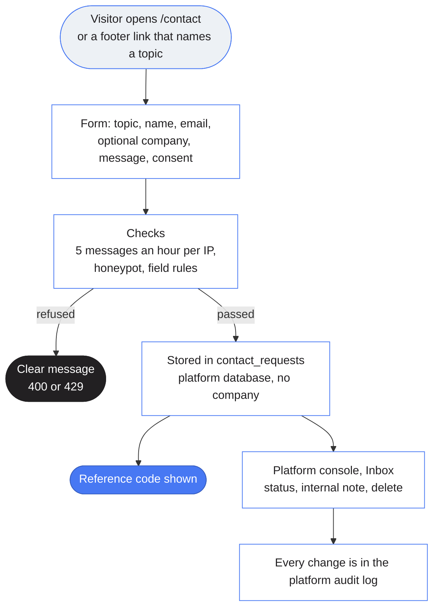

- Topics are sales, support, privacy, security and other. A footer link such as `/contact?topic=security` opens the form on that topic.
- The same message sent twice within ten minutes is stored once. A hidden `website` field is a spam trap: a bot that fills it gets a normal looking reply and nothing is stored.
- Only platform owners can read the inbox, at `/platform/inbox`. A message is personal data, so deleting it from the inbox is how a privacy request about it is honoured.

**Optional details.** The footer and the contact page show a placeholder sales address, `sales@hirely.ai`, until you set your own. Set any of these in `frontend/.env.local`, or in your host's build variables, and they appear where they apply. The other addresses stay empty unless set, and then the contact form is the only channel.

| Variable | What it adds |
|---|---|
| `VITE_CONTACT_EMAIL` | Replaces the placeholder `sales@hirely.ai` in the footer, on the contact page and in the contact sections of the documents that use it |
| `VITE_PRIVACY_EMAIL` | An email address for privacy requests in the Privacy Policy and the Candidate Privacy Notice |
| `VITE_SECURITY_EMAIL` | An email address for security reports on the Security page and in the Acceptable Use Policy |
| `VITE_COMPANY_ADDRESS` | A postal address on the contact page and in the documents that use it |
| `VITE_GOVERNING_LAW` | The governing law clause in the Terms of Service. When empty, the Terms say that governing law is as stated in the order form |

**The legal documents.** Each one is data in `frontend/src/pages/legal/content/<name>.ts`, shown by one template with a contents list, anchored headings, a print button and a last updated date (`LEGAL_UPDATED` in `frontend/src/lib/site.ts`). Tests guard them: unique section ids, only real links, tables with matching columns, no invented contact details, certifications or uptime figures, and the facts that must stay true. The Cookie Policy lists exactly what the app stores, and the Candidate Privacy Notice says that no video is recorded or stored.

> The text describes what the product does today. Have a lawyer review it before you rely on it, and change the date when you edit it.

**Search engines.** Every page sets its own title, description and canonical address. `frontend/public/robots.txt` keeps the dashboard, the platform console, sign in and the one time candidate links out of search results. There is no sitemap, because that needs your public address. The site is a single page app, so the 404 page is served with status 200.

## What gets stored

Hirely.ai keeps its records in one MongoDB database and its vectors in one Pinecone index. Nothing is written to local disk, and résumé files live in MongoDB too.

**MongoDB collections**

| Group | Collections | Holds |
|---|---|---|
| **Directory** (platform only) | `clients`, `companies`, `settings` | Customers, workspaces, plans and the migration marker. Not reachable through the company scoped handle |
| **Hiring** | `jobs`, `resumes`, `resume_files`, `upload_batches`, `applications`, `candidates`, `candidate_profiles`, `candidate_demographics`, `scenarios`, `interviewer_links`, `report_shares` | Job descriptions, résumé records and files, ingestion batches, applications from the careers page, the candidate pipeline with invites and interview data, interview scenarios and the token links to shared reports and scorecards |
| **Offers** | `offers`, `offer_signatures`, `hrms_sync_log` | Offers, the signatures used on letters and the log of pushes to an HRMS |
| **Coding** | `coding_questions`, `coding_submissions`, `coding_session_state` | The question bank, candidate submissions and live session state |
| **Performance** | `employees`, `performance_cycles`, `performance_reviews`, `performance_rating_dimensions`, `goals` | Review cycles, reviews, goals and the rating configuration |
| **People and access** | `users`, `roles`, `security_policies`, `audit_log` | Accounts, custom roles, password and session policy, and the company audit trail |
| **Company setup** | `company_settings`, `branding_settings`, `notification_settings`, `notification_log`, `email_templates`, `prompt_templates`, `departments`, `designations`, `job_grades`, `workflow_rules`, `webhook_subscriptions`, `webhook_deliveries`, `user_guides`, `system_config` | Everything a company configures for itself |
| **Operations** | `email_log`, `cost_ledger`, `cron_runs` | Email delivery history, the per company AI cost ledger and the last run of each scheduled job |
| **Shared plumbing** | `rate_limits`, `sso_states`, `otp_logs`, `password_tokens` | Short lived rate limit, sign-in and one-time code records, shared by every company |

Every row outside the directory and shared plumbing groups carries a `company_id`.

**Careers page records**

- An **`applications`** row is written for each application: `application_id`, `job_id`, `job_title`, `resume_id`, `name`, `email` with a lowercase `email_normalized`, `phone`, `cover_note`, `source` (`career_page`), `status` (`received`), `consent_at` and `created_at`. A unique index on `(company_id, job_id, email_normalized)` allows one application per email per job.
- A **`resumes`** row for a new application carries `source` (`career_page`), `applied_job_id` and an `applicant` object with the name, email and phone. The job's pipeline entry carries `source` and `application_id`, which is how the **Career page** tag is shown.
- A **`jobs`** row carries `is_public`, which decides whether the job is listed. Imported and synced jobs are saved with `false`.

**Pinecone vectors**

- **Jobs** go in the `jobs` namespace and **résumés** in the default namespace, each as a 1536 dimension vector.
- Every vector carries `company_id`, `embedding_model` and `doc_type` (`job` or `resume`), so a query is filtered to the signed-in company and to vectors made by the current embedding model.
- A job's metadata adds its domain, experience level and up to 20 skills. A résumé's adds its domain, seniority, up to 20 skills, a confidence, years of experience, education level and a text snippet of up to 500 characters.
- Vectors written before multi-tenancy have no `company_id` and keep matching for the Default company.

**What an email or a report may contain**

These are compliance rules, not style.

| Message | Contains |
|---|---|
| Candidate **invite** | A link and instructions only, **no scores** |
| Candidate **status** | "Thank you, we will be in touch", **no report content** |
| **Report** with scores and recommendation | Admin only, through the authenticated `/api/v1/interview/report/{token}` endpoint |
| **Shared report** for a hiring manager | A link an admin with `interview:share_report` creates and passes on themselves. It expires, can be revoked, counts views, and is never emailed by the system |
| **PDF export** | Admin only, **never emailed** |

## Using the app

After sign in, a sidebar leads to **Overview**, **Recruiting**, **Résumés**, **HRMS**, **Performance**, the admin pages and the in-app **User Guide**. The top bar shows who you are and holds the needs attention menu. What you see depends on your [role](#roles-and-permissions), and the examples below were captured in demo mode.

### 1. Sign in

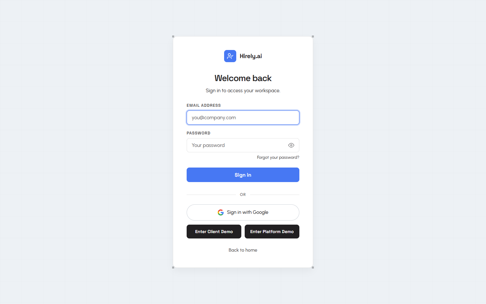

Sign in with a password, or through **Sign in with Google** or the company's own OpenID Connect button. Accounts can also use an emailed one-time code or an authenticator app with recovery codes. **Forgot your password?** sends a reset link, and new users get an invitation email. Password rules, lockout and session timeout come from **Security Policies**. **Enter Client Demo** and **Enter Platform Demo** are for [demo mode](#try-it-in-demo-mode).

### 2. Overview


**Recruitment Overview** opens with a **Get started** checklist for a new company: profile, branding, a teammate, a job and résumés. Below it are tiles for résumés, open JDs, domains, distinct skills, seniority levels and hires, then **Pipeline Composition** and the **Hiring Funnel**, with a cost overview underneath. **Create JD**, **Import JDs** and **Upload Résumés** sit at the top right.

### 3. Recruiting

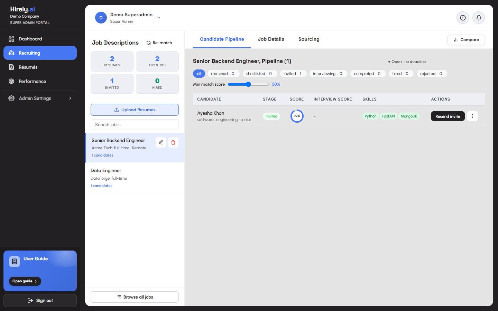

The list on the left holds your job descriptions, with **Re-match** and a search box. For the selected job there are four tabs.

- **Candidate Pipeline** lists candidates with their stage, match score, interview score and skills. Filter by **all**, **matched**, **shortlisted**, **invited**, **interviewing**, **completed**, **hired** and **rejected**, set a minimum match score, and use the row actions such as **Resend invite**. **Compare** puts candidates side by side.
- **Job Details** shows the job description and its settings, a **Résumé Limit** block (how many résumés are taken out of **Max résumés**, and whether the JD is full), and a **Careers page** block with the job's public link, a **Copy** button and **Open page**. Candidates who applied there carry a **Career page** tag in the pipeline.
- **Sourcing** generates boolean search strings (strict, balanced, broad) for external sites.
- **Remove Low Matches** (HR Admin and Super Admin) takes a minimum match score and lists the résumés below it before anything changes. **Remove from this JD only** keeps the résumé in the system and in its other JDs, and the JDs popup on the Résumés page then shows that JD as **Low score, removed by admin**. **Delete from the system completely** deletes the résumé, its file and its place in every JD. Hired candidates are always kept, and new matches below the minimum are not added to that JD later.

### 4. Résumés

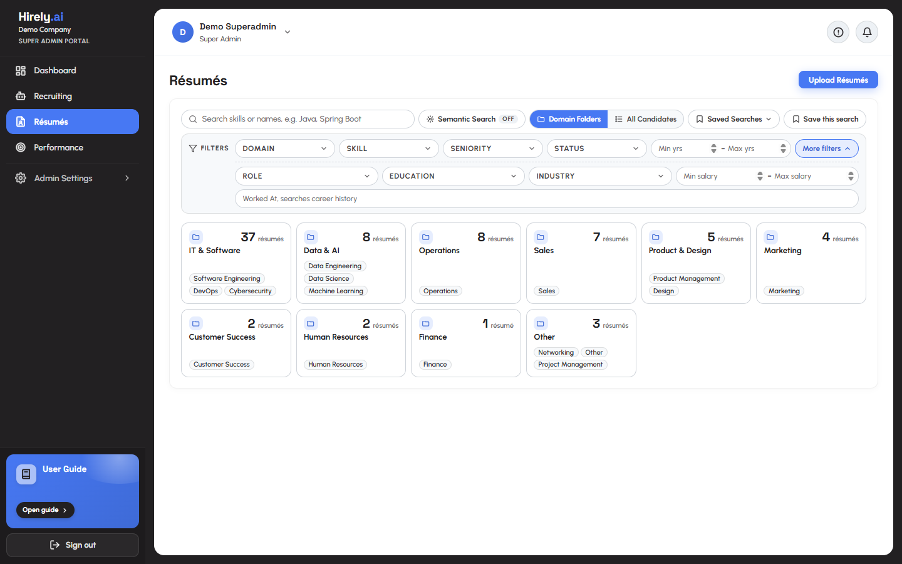

The whole résumé pool in one place. The page opens on **Domain Folders**: one small tile per business domain (IT & Software, Data & AI, Operations and so on) with its résumé count and its top roles. Open a tile, or switch to **All Candidates**, to see the table. The toolbar works the same in both views, and the view is never written into the address.

- **Search** takes skills or names, for example `Java, Spring Boot`. Commas separate terms, every recognized skill and every word must match, and a skill matches whole words only, so Java never finds JavaScript. **Semantic Search** matches by meaning instead of keywords. It is off until you switch it on, makes one embedding call per search, counts as an AI action, and falls back to the keyword list if it is unavailable.
- **Filters** are Domain, Skill (several at once), Seniority, Status, and Min and Max years of experience. **More filters** adds Role, Education, Industry, Min and Max salary and **Worked At**, which searches career history. Active filters show as chips with **Clear all**.
- **Saved Searches** keeps the filters you have applied under a name, so you can reapply them later. They belong to you.
- **Table:** open a résumé in the in page viewer with **View**, **Delete** one or select many, and press **Upload Résumés** to add up to 500 files per batch. Each row shows the parsed profile: domain, seniority and top skills.
- **JDs** opens a scrollable popup of every job description the résumé is in, highest score first, for example "Ana Ruiz scored 59 against this JD". A JD the résumé was removed from as a low match shows **Low score, removed by admin** with no score.

Role and Worked At use fields that are read from the résumé text when it is parsed (the latest job title and recent employers). Résumés parsed before these filters existed fill them only after they are read again. `python -m scripts.backfill_resume_profiles --company <company_id>` counts them and estimates the cost without calling the model, and `--apply` does the work with your OpenAI key. A new upload reads a little more text, which adds about $0.0003 per résumé.

### 5. HRMS

Everything about people after they are hired, on one page with six tabs. HR Admin and Super Admin manage it, and recruiters can read it.

| Tab | What it does |
|---|---|
| **Overview** | Six tiles (headcount, on leave today, present today, pending leave, 30 day attendance and 12 month attrition) that each open their tab, then charts over a 6, 12 or 24 month range: headcount, joiners and leavers, the daily attendance rate, leave taken by type, headcount by department, and tenure with the employment type mix. Every chart has a hover readout and a **Show table** view. On leave today, new joiners and upcoming holidays sit underneath. |
| **People Insights** | **Hire quality**: the résumé match and AI interview score each hire had, next to their performance score and attendance, a verdict per person, and a plain answer to whether interview scores predict performance. **Flight risk and burnout radar**: a score from 0 to 100 per employee with its reasons, such as single sick days next to weekends, a fall in attendance, long days, no leave in 120 days, no manager or a low review. HR Admin and Super Admin only. |
| **Employees** | A directory with search and department and status filters. Columns sort on a click, the list is paged (10, 25, 50 or 100 rows) and **Export CSV** downloads what the filters show. Add, edit, view and offboard. People hired through accepted offers appear automatically with their candidate name and email. The profile shows the leave balance for the year. |
| **Leave** | Requests for an employee, approve, reject or cancel, searched and paged on the server with a count on every status filter, and leave types with yearly allowances (Annual 14, Sick 8 and Casual 6 to start). Only working days count, overlaps and requests over the balance are refused, and approved leave fills the attendance sheet. **Approve** first checks team coverage and stops to show who else is off when the department would be under half strength. |
| **Attendance** | A daily sheet to mark present, remote, half day, absent or on leave with check in and check out times, searchable and paged, where the status totals double as filters, and a monthly summary with hours, an attendance rate bar and **Export CSV**. |
| **Holidays** | The company holiday calendar by year. Holidays are skipped when leave is counted. |

The data lives in the company's own `employees`, `leave_types`, `leave_requests`, `attendance` and `holidays` collections, behind the `hrms:read` and `hrms:manage` permissions.

### 6. Settings

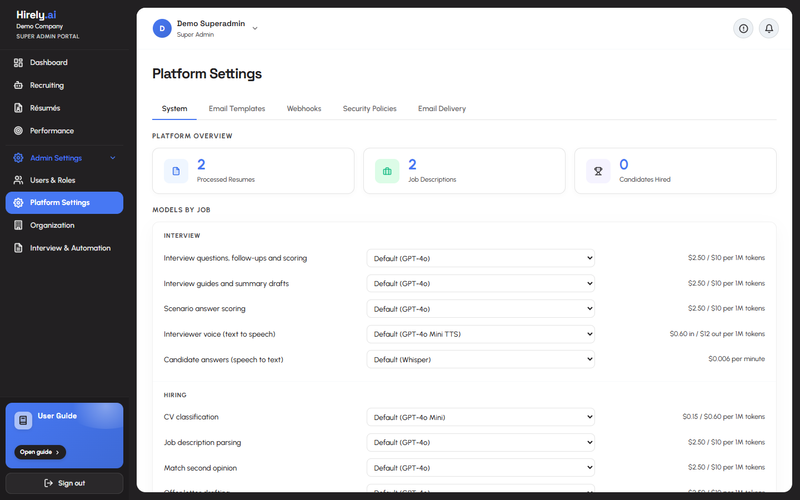

A company's configuration lives on four settings pages, each a tabbed page driven by `?tab=`.

| Page | Tabs |
|---|---|
| **Users & Roles** | Users, Roles & Permissions (the permission matrix), Audit Log |
| **Platform Settings** | System (usage stats, **Models by Job**, environment), Email Templates, Webhooks, Security Policies, Email Delivery |
| **Organization** | Company Profile, Branding & Notifications, Departments, Designations & Grades, plus four superadmin only tabs: Email (the company's own SMTP), Sign-in (OpenID Connect), Integrations (HRMS, Zoom, Teams) and Data (retention and erasure) |
| **Interview & Automation** | Scenarios, Workflow Rules, Coding Questions, Live Sessions, Submissions |

Under **Models by Job** a company can route each AI job (interview questions and scoring, interview guides, scenario scoring, interviewer voice, candidate answer transcription, CV classification, JD parsing, match second opinion, offer letter drafting) to its own model, and re-index when the embedding model changes. Prompt overrides are still served by `/api/v1/prompt-config`, but there is no settings tab for them.

### 7. Performance

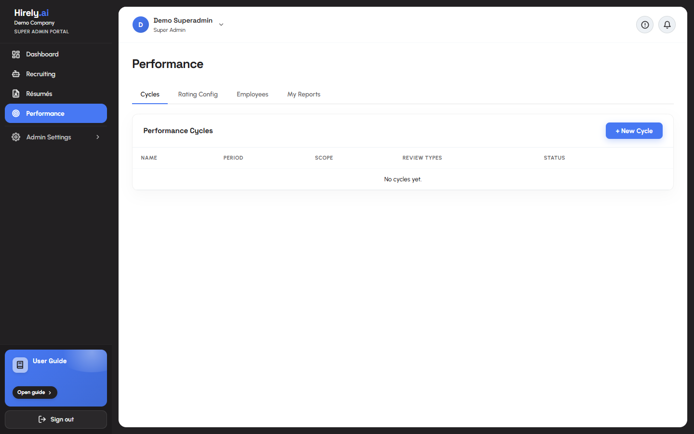

A review cycle module for existing employees. Run cycles scoped to the organization, a department or a job grade, with self, manager, peer and skip level reviews. Self and peer reviewers use a token link (`/performance-review/:token`), and managers use the **My Reports** tab. Rating dimensions and the rating scale are configurable per company under **Rating Config**, and tabs are shown by permission.

### 8. The platform console

Platform owners see `/platform` instead of the recruiting screens: Overview, Clients (with a page per client and per company), Inbox, Usage, AI models, Billing, Health, Audit and Platform owners. See [The platform console](#the-platform-console).

### 9. The careers site

The public side of your jobs. It needs no account, and anyone can open it, including the candidates you want to reach.

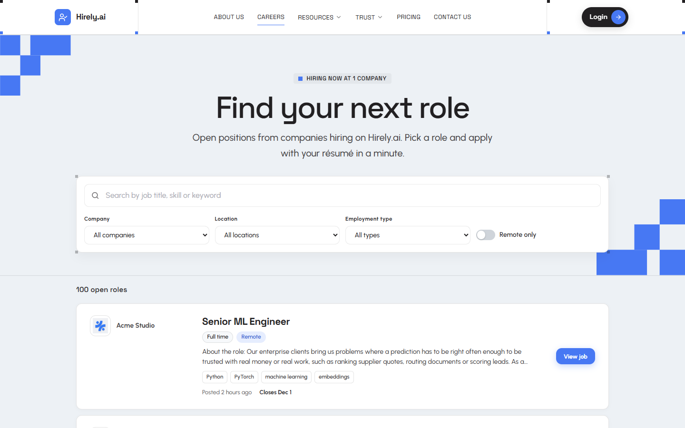

1. Open `/careers`. Search, or narrow by company, location, employment type and remote work, and page through the results.
2. Open a job to read the full description at `/careers/:jobId`.
3. Fill in the apply form: name, email, an optional phone number and note, consent, and a résumé (PDF, DOC, DOCX or TXT, up to 4 MB).
4. Press apply. A reference code confirms it, and the application appears in that company's pipeline for the job. See [Careers page](#careers-page).

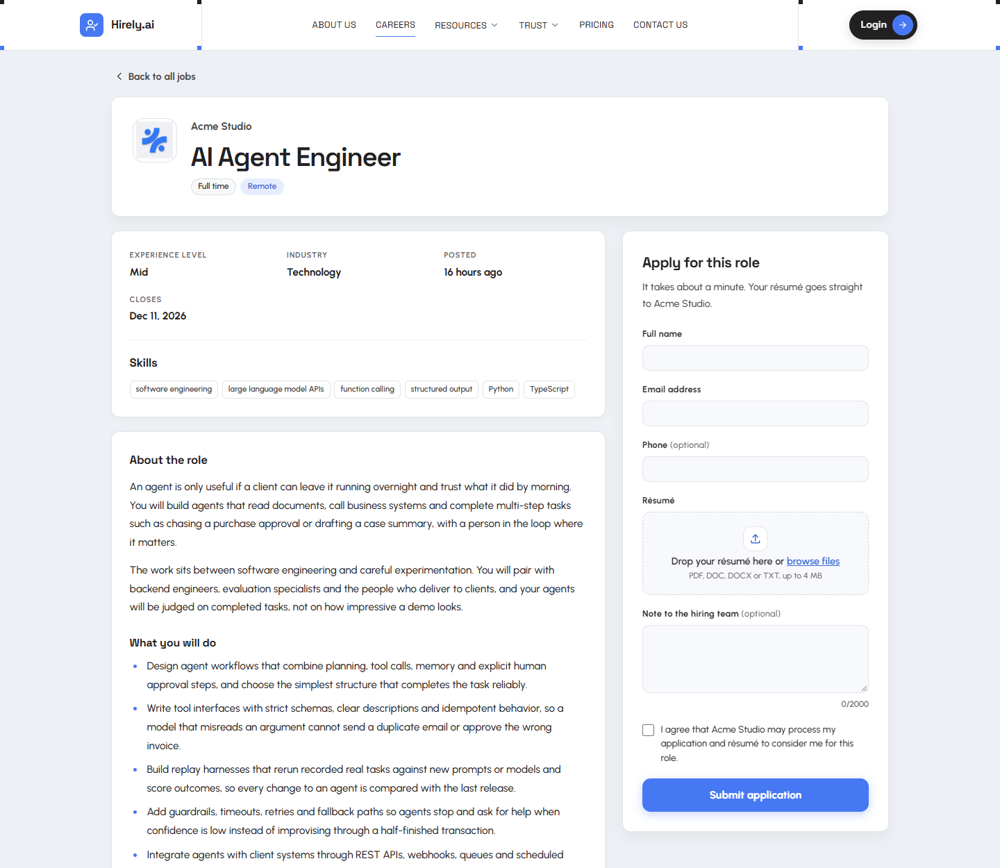

### Pages guests see

Candidates, hiring managers and reviewers never sign in. Most arrive through private links. The careers pages are open to everyone, with no link needed.

| Path | Page |
|---|---|
| `/`, `/about`, `/features`, `/integrations`, `/compare`, `/roi-calculator`, `/faq`, `/candidates`, `/trust`, `/pricing`, `/security`, `/responsible-ai`, `/contact` | The public website. See [The public website](#the-public-website) |
| `/terms`, `/privacy`, `/candidate-privacy`, `/cookies`, `/acceptable-use`, `/dpa`, `/subprocessors`, `/accessibility` | The legal documents |
| `/careers` | The public list of open jobs from all active companies, with search, filters and pagination |
| `/careers/:jobId` | One public job with its full description and the apply form |
| `/interview/:token` | The candidate's voice interview, with proctoring |
| `/coding/:token` | The candidate's coding assessment |
| `/offer/:token` | Offer acceptance |
| `/performance-review/:token` | A self or peer performance review |
| `/report/shared/:token` | A shared interview report for a hiring manager, read only, with a feedback box |
| `/interviewer/:token` | A scorecard form for a human interviewer |

## Roles and permissions

There are three built in roles per company, plus custom roles an admin authors, plus the platform owner flag.

| Role | Sidebar reads | Can do |
|---|---|---|
| `standard` | Recruiter Portal | Read only access to jobs, résumés, intel, candidates, coding, scenarios, offers, analytics and HRMS (9 of 60 permissions) |
| `admin` | HR Admin Portal | 56 of 60 permissions and the four admin pages. Everything except `users:manage`, `rbac:manage`, `security:manage` and `candidates:erase` |
| `superadmin` | Super Admin Portal | All 60: users, roles and custom roles, security policies, erasure and retention, and the company's own mail, sign-in and integrations |
| platform owner | Platform console | An account flag, `is_platform_admin`, not a role. Reaches `/platform` and the `/api/v1/platform` routes, and sees counts and spend rather than company data |

The public [careers pages](#careers-page) (`/careers` and `/careers/:jobId`) and the four `/api/v1/careers` routes need no account at all. What appears there is controlled by the job's **Show on the careers page** setting, which is saved through `jobs:update` (to set it when creating a job, `jobs:create`). Those permissions belong to **HR Admin** (`admin`) and **Super Admin** (`superadmin`), not to the read only `standard` role.

<details>
<summary>How permissions are enforced</summary>

- Permission strings live in `services/hr_module/permissions.py`. `resolve_permissions(role)` checks the company's custom roles first, then the built in defaults.
- Routes use the dependencies in `shared/auth.py`: `require_admin`, `require_superadmin`, `require_permission("area:action")` and `require_any_permission(...)`. Platform routes use `require_platform_admin`.
- **A new endpoint needs its permission string registered in `permissions.py`**, or RBAC silently allows everyone who passes the role check.
- Plan feature switches stack on top. A permission can be granted while the company's plan has the feature switched off, in which case the admin routes answer 402.
- Department scoping through `get_department_scope` narrows visibility where a `department_id` is set. A job with none stays visible to everyone. `departments:cross_scope` lifts it.
- Account safeguards: only a superadmin can modify a non standard account, nobody can change their own role or deactivate themselves, the last active superadmin cannot be demoted or deactivated, and platform owner accounts cannot be touched by a company administrator.
- The needs attention menu is shown to admins and superadmins, and its endpoints need the `attention:read` permission.

</details>

## Settings reference

<details>
<summary>Every environment variable and its default</summary>

Everything not listed here has a working default in `backend/config/settings.py`, and `backend/.env.example` lists every setting, grouped. Unknown keys are ignored because `Settings.Config` sets `extra = "ignore"`, so a misspelled variable fails silently. Check spelling against `settings.py` if a setting seems to do nothing.

**Required**

| Variable | Default | Purpose |
|---|---|---|
| `SECRET_KEY` | none | Signs every JWT. 32+ random characters. |
| `DEFAULT_SUPERADMIN_EMAIL` | `superadmin@hirely.ai` | The platform owner, seeded on the first DB connection. |
| `DEFAULT_SUPERADMIN_PASSWORD` | none | 12+ chars, not a common password. |
| `MONGODB_URI` | `mongodb://localhost:27017` | On Vercel this must be an Atlas SRV string. |
| `MONGODB_DB` | `hr_bot` | Database name. `.env.example` sets `hirely`. Keep the name of any database you already have. |
| `OPENAI_API_KEY` | none | Parsing, classification, matching, interviews, embeddings, TTS, transcription. |
| `FRONTEND_URL` | `http://localhost:5173` | Every candidate facing link is built from this, unless a company has a custom domain. |

**Recommended**

| Variable | Default | Purpose |
|---|---|---|
| `SECRETS_ENCRYPTION_KEY` | derived from `SECRET_KEY` | Encrypts credentials that companies store (SMTP, SSO, integrations). Set it separately in production. |
| `SECRETS_ENCRYPTION_KEY_PREVIOUS` | none | Comma separated old keys still accepted while you rotate. |
| `CRON_SECRET` | none | Bearer secret for `/api/v1/cron/*`. On Vercel, without it the scheduled jobs are disabled. |
| `PINECONE_API_KEY` | none | Without it, résumé to JD vector matching is disabled. |
| `PINECONE_INDEX_NAME` | `hr-bot` | The index must be created with **dimension 1536**. `.env.example` sets `hirely`. |
| `PINECONE_ENV` | `us-east-1` | Pinecone region. |
| `ALLOWED_ORIGINS` | `["http://localhost:5173","http://localhost:3000","http://localhost:8000"]` | CORS allowlist, JSON array. |
| `ALLOWED_ORIGIN_REGEX` | none | Extra CORS origins by regex. |
| `ALLOW_NGROK_ORIGINS` | `false` | Allow ngrok origins (always on under `DEBUG`). |
| `CLIENT_IP_HEADER` | none | Header that carries the real client IP behind a proxy, used by rate limits and lockout. On Vercel `x-vercel-forwarded-for` is used automatically. |
| `EXPOSE_API_DOCS` | `false` | Serve `/api/docs`, `/api/redoc` and `/api/openapi.json` outside `DEBUG`. |
| `DEBUG` | `false` | Verbose logs and relaxed startup checks. **Must be false in production.** |
| `STRICT_SECURITY_VALIDATION` | `false` | Turns startup weak value warnings into a refusal to boot. |
| `ALLOW_DEMO_AUTH` | `false` | **Danger.** `Bearer demo-<role>-token` grants any role with no credentials. The app refuses to boot with it on unless `DEBUG=true`. Local UI work only. |
| `HACKATHON_DEMO_MODE` | `false` | With `ALLOW_DEMO_AUTH`, makes demo accounts' destructive calls simulated. |
| `DEMO_COMPANY_ID` | empty | With `ALLOW_DEMO_AUTH`, shows this company in **Enter Client Demo** and makes every demo request that is not a read simulated. See [Show a real company in the demo](#show-a-real-company-in-the-demo). |

**Optional integrations**

| Group | Variables | Effect when unset |
|---|---|---|
| **Email** | `EMAIL_HOST` `EMAIL_PORT` `EMAIL_USERNAME` `EMAIL_PASSWORD` `EMAIL_FROM` `EMAIL_FROM_NAME` `EMAIL_USE_TLS` `EMAIL_ESTIMATED_COST_PER_EMAIL` | No invite, OTP, status or offer email is delivered. Links must be copied from the UI by hand. A company can still configure its own SMTP server. |
| **AWS SES** | `AWS_SES_ENABLED` `AWS_SES_REGION` | Alternative to SMTP. |
| **Code sandbox** | `CODE_SANDBOX_PROVIDER` `JUDGE0_API_URL` `JUDGE0_API_KEY` `JUDGE0_API_HOST` `PISTON_API_URL` `PISTON_API_KEY` | Assessments can be taken but code cannot be executed. |
| **Second LLM** | `ANTHROPIC_API_KEY` | Adds Claude models to the picker. Does **not** cover embeddings, TTS or transcription. |
| **SSO** | `GOOGLE_OAUTH_CLIENT_ID` `GOOGLE_OAUTH_CLIENT_SECRET` `GOOGLE_OAUTH_REDIRECT_URI` `SSO_ALLOWED_EMAIL_DOMAINS` | Google sign in unavailable. OpenID Connect is configured per company in the UI and needs no variables. |
| **Meetings** | `MEETING_PROVIDER` `ZOOM_*` `MS_TEAMS_*` | No meeting links on scheduled interviews. Applies to the Default company only, other companies enter their own. |
| **Outbound** | `WEBHOOK_SIGNING_SECRET` `HRMS_WEBHOOK_URL` `HRMS_AUTH_HEADER` `HRMS_AUTH_TOKEN` `HRMS_AUTO_PUSH_ON_HIRE` | No signed webhooks and no HRMS push. The `HRMS_*` values apply to the Default company only. |
| **Job boards** | `LINKEDIN_API_KEY` `INDEED_API_KEY` `JOB_IMPORT_SYNC_INTERVAL_HOURS` | Only LinkedIn and Indeed take a key. Remotive, Arbeitnow, RemoteOK, The Muse and Jobicy are free sources. Manual JD entry is the normal path. |
| **Billing** | `STRIPE_SECRET_KEY` `STRIPE_WEBHOOK_SECRET` `STRIPE_PRICE_IDS` (JSON, `{"tier": "price_id"}`) | No Stripe checkout or portal. Statements and manual subscription status still work. |
| **Operator** | `PLATFORM_ALERT_EMAILS` (comma separated) `TERMS_URL` `PRIVACY_URL` | Alerts go only to platform owners. No default terms and privacy links on sign-in. |

**Tuning**

| Variable | Default | Purpose |
|---|---|---|
| `DEFAULT_LLM_MODEL` | `gpt-4o` | Overridable per request, per company by an admin, or per job under Models by Job. |
| `RESUME_CLASSIFICATION_MODEL` | `gpt-4o-mini` | Cheaper model for classification. |
| `RESUME_EMBEDDING_MODEL` | `text-embedding-3-small` | 1536 dimensions, must match the Pinecone index. |
| `LLM_EFFORT` | `low` | Reasoning effort for models that support it (`low`, `medium`, `high`). |
| `RESUME_SIMILARITY_THRESHOLD` | `0.35` | Below this a match is not stored. |
| `CROSS_DOMAIN_SIMILARITY_THRESHOLD` | `0.55` | Higher bar for cross domain matches. |
| `AUTO_INVITE_ENABLED` | `false` | Master switch. While off, matches wait for a recruiter to invite. |
| `AUTO_INVITE_THRESHOLD` | `0.70` | With auto invite on, at or above this the system invites with no human review. |
| `RESUME_TOP_N_MATCHES_PER_JD` | `20` | Matches retained per job description. |
| `MAX_BULK_UPLOAD_FILES` | `500` | Per batch résumé ceiling. |
| `CAREERS_MAX_RESUME_MB` | `4` | Largest résumé file a candidate can attach on the careers page. Keep it under the roughly 4.5 MB request cap on Vercel. |
| `CAREERS_APPLICATIONS_PER_HOUR` | `120` | Careers page applications one company accepts per hour, whoever applies. Over it answers 429. |
| `CAREERS_CACHE_SECONDS` | `30` | How long the public job list, its filters and the company index are cached in memory. `0` turns the cache off. |
| `INTERVIEW_DURATION_MINUTES` | `30` | Target interview length. |
| `INTERVIEW_QUESTION_COUNT` | `15` | Questions generated. |
| `INTERVIEW_GUIDE_QUESTION_COUNT` | `10` | Questions in a generated interview guide. |
| `TTS_VOICE` | `alloy` | OpenAI TTS voice. |
| `ACCESS_TOKEN_EXPIRE_MINUTES` | `1440` | JWT lifetime, 24 hours. |
| `INVITE_LINK_EXPIRY_DAYS` | `7` | Candidate link validity. |
| `CODING_LINK_GRACE_DAYS` | `30` | How long a coding link outlives its interview link when it carries no expiry of its own. |
| `REPORT_SHARE_EXPIRY_DAYS` | `7` | Default life of a shared report link (a sender can pick 1 to 30). |
| `PERFORMANCE_REVIEW_EXPIRY_DAYS` | `30` | Life of a self or peer review link. |

> **The two thresholds are the product.** `0.35` decides what a recruiter *sees* in the pipeline. `0.70` decides what the system *acts on* without a human, once `AUTO_INVITE_ENABLED` is on. The gap between them is the review step. Moving them together removes it.

**Tests only**

`MONGODB_TEST_URI`, `MONGODB_TEST`, `PINECONE_API_KEY_TEST` and `PINECONE_INDEX_NAME_TEST`. The suite runs against these when set, so it never touches real data.

</details>

## Tech stack

The badges at the top of this page link here.

| Layer | Tools | What they do here |
|---|---|---|
| Backend | FastAPI 0.115+, Uvicorn, Pydantic 2 | The HTTP API, OpenAPI generation, env backed settings |
| Database | MongoDB, Motor 3.6+ and PyMongo | The async store for every record, scoped per company |
| Vector search | Pinecone 5.4+ | Résumé to job matching on 1536 dimension vectors |
| AI | OpenAI (`gpt-4o`, `gpt-4o-mini`, `text-embedding-3-small`, TTS, transcription), optional Anthropic Claude | Parsing, classification, matching, interviews, evaluation, embeddings and voice |
| Agents | LangGraph, LangChain | The résumé and interview pipelines |
| Documents | pdfplumber, python-docx, olefile, ReportLab | Résumé text extraction and the PDF reports and offers |
| Security | python-jose, passlib with bcrypt, cryptography | JWTs, password hashing and encrypting company secrets (Fernet) |
| Mail and web | aiosmtplib, httpx, APScheduler | SMTP, outbound calls (job boards, sandbox, Stripe, OpenID Connect) and the in-process scheduler |
| Frontend | React 18.3, TypeScript 5.7, Vite 6 | The single page app, in Space Grotesk and Urbanist |
| State and routing | React Router 6, Zustand 5, axios | Routes and guards, auth and model state, the HTTP layer in `src/lib/api.ts` |
| Proctoring and preview | MediaPipe tasks-vision, mammoth, docx-preview | In browser proctoring and in browser résumé preview |
| Testing | pytest with pytest-asyncio, Vitest 2 with Testing Library and jsdom, ESLint 9 | 3,611 backend tests and 3,116 frontend tests |
| Where it runs | Vercel (static build plus a Python function), or any host that runs uvicorn | One project, one domain |

There is **no Tailwind, no CSS-in-JS, no component library and no icon package.** Styling is one plain `.css` file per component using the custom properties in `frontend/src/index.css`, and icons are inline SVG components.

## Where your data goes

<details>
<summary>Which services see what</summary>

Records stay in your MongoDB, and each company's rows are confined to that company. Beyond that, only the services you switch on receive data.

| Service | What it receives | When |
|---|---|---|
| MongoDB | Every record, including résumé files | Always |
| OpenAI | Résumé and job text for parsing, classification and embeddings, interview questions and answers, audio for transcription and text for the interviewer's voice | Always for embeddings, speech and transcription. Other AI jobs go to OpenAI unless a company routes them to another provider |
| Anthropic | The text of any AI job routed to a Claude model | Only with `ANTHROPIC_API_KEY` set and a model chosen |
| Pinecone | Vectors and the metadata listed under [What gets stored](#what-gets-stored) | Only with `PINECONE_API_KEY` set |
| SMTP or AWS SES | Invites, status messages, offers, one-time codes and reset links. Invites and status messages carry no scores | Only when mail is configured, by the platform or by the company |
| Judge0 or Piston | The code a candidate runs in the assessment | Only when a sandbox provider is configured |
| Stripe | Billing for a client | Only with the Stripe keys set |
| An HRMS webhook | Hired candidates | Only when configured |
| Job boards | Outbound imports of public job postings | When you import. LinkedIn and Indeed need a key |

Proctoring runs in the candidate's browser, with its assets served from your own deployment. Platform owners see counts and spend, never candidate, résumé, interview or report content. Erasing a candidate removes them from every store, vectors included, and leaves an anonymised tombstone so counts and the audit trail stay true. A company can set retention periods, and a daily job erases candidates in a final state (rejected, not selected, withdrawn) and résumés that belong to no candidate once they are older than that. By default only a company's superadmin can do either.

</details>

## Questions and tips

<details>
<summary>Do I need Pinecone, an SMTP server or an Anthropic key?</summary>

No. An OpenAI key alone is enough, because the default models are OpenAI. Without Pinecone, vector matching is disabled and everything else works. Without SMTP, emails are generated but never sent, and you copy links from the UI by hand. A company can also bring its own SMTP server. An Anthropic key only adds Claude models to the picker, and it does not cover embeddings, text to speech or transcription.

</details>

<details>
<summary>What does the first sign in look like?</summary>

Use the `DEFAULT_SUPERADMIN_EMAIL` and `DEFAULT_SUPERADMIN_PASSWORD` from your `.env` at `/login`. On a fresh database you land on the platform console at `/platform`, where you create a client with its first company and administrator. That administrator signs in at `/login?company=<slug>`. Platform owners use the console only, so signing in as the owner and seeing no recruiting screens is expected.

</details>

<details>
<summary>The app refuses to boot, or a feature silently does nothing</summary>

A refusal to boot means `SECRET_KEY` is still the shipped value, `DEFAULT_SUPERADMIN_PASSWORD` is missing, or `ALLOW_DEMO_AUTH` is on while `DEBUG` is off. The startup audit also flags placeholder looking values such as `change-me`, `example`, `your-`, `todo` and `xxx`, and with `STRICT_SECURITY_VALIDATION=true` those become a refusal to boot too. Set real values, or set `DEBUG=true` for local work.

A feature that does nothing usually has an unset key. Re-read the startup log, which prints one line per disabled capability. Unknown settings are dropped silently, so also check the spelling against `backend/config/settings.py`.

</details>

<details>
<summary>MongoDB authentication fails, or the tests say the database is not initialized</summary>

`bad auth : authentication failed` means MongoDB rejected the credentials, so check `MONGODB_URI`, the Atlas user's password and the network access list. "Database connection not initialized" in the tests means no reachable MongoDB: set `MONGODB_TEST_URI`, or run `pytest tests/unit`, which needs none.

</details>

<details>
<summary>Matching returns nothing</summary>

There is no `PINECONE_API_KEY`, or the index was not created with dimension 1536. If this started after an upgrade, vectors written before multi-tenancy carry no company tag and match for the Default company only. Tag them with `scripts/backfill_pinecone_company.py --apply`.

</details>

<details>
<summary>Emails never arrive, or candidate links point at the wrong host</summary>

For missing email, there is no `EMAIL_HOST` or `AWS_SES_ENABLED`, or the company's own mail settings are incomplete. Check **Platform Settings > Email Delivery**. Links can always be copied from the UI. For a wrong host, `FRONTEND_URL` is wrong, or the company has a custom domain set.

</details>

<details>
<summary>An existing database looks different after the first start</summary>

Expected. The first start against a database from before multi-tenancy runs a one-time, idempotent migration that creates the Platform and Default workspaces and stamps `company_id` on every row. Your data is now the Default company. Preview it with `scripts/migrate_multitenant.py` before you start, as described in [Migrating an existing database](#migrating-an-existing-database).

If data looks missing after upgrading and the log says "Tenancy migration failed", rows without a `company_id` are invisible to every company. Fix the cause shown in the log, then run `scripts/migrate_multitenant.py --apply`.

</details>

<details>
<summary>Sign in answers 403, or an AI action answers 402 or 429</summary>

A 403 with "This workspace is suspended", or "trial has ended", means the client or company is suspended, or its trial or subscription ended. A platform owner changes that in the console. A 402 or 429 on an AI action means the company reached its plan's monthly AI budget (402) or its hourly allowance (429).

</details>

<details>
<summary>Scheduled jobs never run on Vercel, or saved SMTP and SSO credentials stop working</summary>

If `/api/v1/cron/*` answers 503, `CRON_SECRET` is not set, so the jobs are disabled. Set it in the Vercel project and redeploy. If stored company credentials stop working, `SECRETS_ENCRYPTION_KEY` changed, or it was unset and `SECRET_KEY` changed. Put the old value in `SECRETS_ENCRYPTION_KEY_PREVIOUS`.

</details>

<details>
<summary>An endpoint that exists answers 404, or /api/docs is missing</summary>

`main.py` sets `redirect_slashes=False`, so `/api/v1/jobs` and `/api/v1/jobs/` are **different paths**. The Swagger and ReDoc pages are off by default: set `EXPOSE_API_DOCS=true` or run with `DEBUG=true`.

</details>

<details>
<summary>The interview page fails to load proctoring</summary>

`npm run setup:mediapipe` did not complete. Re-run it from `frontend/`. Candidates also need camera and microphone permission, and a browser with a secure origin. Chrome is recommended.

</details>

<details>
<summary>Why is my job not on the careers page?</summary>

A job is listed only when all of these hold: **Show on the careers page** is ticked in the job form (imported jobs start unticked), the job is still open (no deadline, or one in the future), and the company is active, meaning not suspended, no ended trial or subscription, and not the Platform workspace. Changes show within about a minute because the public responses are cached for 30 seconds. The full rules are under [Careers page](#careers-page).

</details>

<details>
<summary>Can a candidate apply to the same job twice?</summary>

No. One application is accepted per email address per job, compared in lowercase, and a second attempt answers 409 "You have already applied to this job with this email address." The same person can apply to different jobs. If the identical résumé file is already on record, it is attached to the job without being processed again.

</details>

<details>
<summary>Does the candidate get an email when they apply?</summary>

No. The careers page sends no email to the candidate. They see a confirmation with a reference code on screen. Invitations and status messages go out only when a recruiter, or auto invite, sends them from the pipeline.

</details>

<details>
<summary>An application is refused with 413, 415, 422 or 503</summary>

415 means the file is not a PDF, DOC, DOCX or TXT, or its content does not match its type. 413 means it is over `CAREERS_MAX_RESUME_MB`. 422 means no readable text was found, which is typical for a scanned PDF with no text layer, or the file is a password protected Word document, so ask for a text based PDF or an unprotected Word file. 503 "not accepting applications right now" means the company has used up its AI budget or storage. A raised budget or limit, or more storage, clears it.

</details>

<details>
<summary>How is a candidate's data removed?</summary>

Erasing the person from **Organization > Data**, deleting their résumé, or a retention purge of that résumé also deletes their `applications` record. Erasure matches an application by the candidate's email as well as by résumé. See [Where your data goes](#where-your-data-goes).

</details>

<details>
<summary>What does Hirely.ai deliberately not do?</summary>

In scope is the recruiting pipeline end to end: job descriptions, a public careers page with applications, résumé ingestion and matching, the candidate pipeline, AI voice interviews with proctoring, coding assessments, external interviews, shared reports and scorecards, offers and analytics, performance reviews, data governance, the four admin settings pages, and the multi-tenant platform console with plans, usage, billing and per company configuration. These are product decisions rather than gaps to fill in passing, and adding any of them means building a backend and a frontend:

| Not built | What that means in practice |
|---|---|
| A public talent marketplace | No searchable profile directory, no shareable candidate links |
| An alumni network | No alumni directory, career graph or re-engagement campaigns |
| A backup and restore admin UI | No in-app export or import of platform data. Back up MongoDB itself |
| SAML single sign-on | OpenID Connect is built (any compliant provider), SAML is not |
| Passkeys | Sign in is by password, email code, authenticator app, Google or OpenID Connect |

Stripe is optional. Without its keys, billing is manual: the console produces statements and an owner sets a client's subscription status by hand.

</details>

## For developers

The backend is FastAPI on Python 3.11+ (developed and tested on 3.14) and the frontend is React with Vite and TypeScript. They deploy together as a single Vercel project.

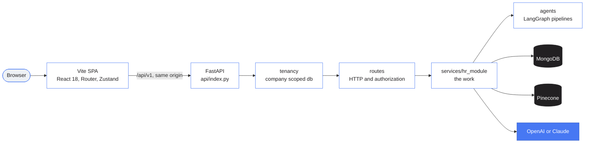

**Layering rule:** `routes/` does HTTP only, meaning validation, authorization and response shaping. Anything reusable lives in `services/hr_module/`. `agents/` holds the LangGraph pipelines. Beneath all of it, `config/tenancy.py` confines every database query to the signed-in company. The codebase is about 181,000 lines across 695 files (tests included): 47.8% Python, 42.3% TypeScript and 9.8% CSS.

```text
AI-HR-Automation-System/
  api/index.py            Vercel entrypoint, wraps backend/main.py and nothing else
  vercel.json             build, function config, /api rewrites, the daily cron
  requirements.txt        the deployable dependency list (Vercel reads root)
  docs/assets/            README screenshots

  backend/
    main.py               app, CORS, tenant middleware, one include_router per area, lifespan
    requirements.txt      includes the root list, for local installs
    requirements-dev.txt  adds pytest, never installed by Vercel
    .env.example          every setting, grouped
    routes/               42 routers, 334 endpoints (careers.py and site.py are the public APIs, platform_inbox.py is the owner inbox)
    services/hr_module/   85 service modules, the actual work (careers_service, application_service, resume_intake_service run the careers page, site_service runs pricing and contact, legacy_doc reads old Word files)
    agents/               base_agent, resume_agent, interview_agent
    shared/               auth deps, tenant_deps, rate_limit, quotas, secrets, safe_http, links, schemas, utils
    config/               settings (env), database (get_db, get_platform_db), llm (ask_llm), tenancy, tenancy_migration
    scripts/              migrate_multitenant, backfill_pinecone_company, seed_production_data (demo data),
                          seed_user_guides (the in-app User Guide), backfill_resume_profiles, sandbox installer
    docs/                 hr_module.md, api_reference.json
    tests/                92 API test modules plus 82 in tests/unit/ (no DB needed)

  frontend/
    scripts/setup-mediapipe.mjs   vendors about 15 MB of proctoring assets at build time
    src/App.tsx                   every route, with PrivateRoute, AdminRoute and PlatformRoute guards
    src/components/               layout (DashboardLayout, PlatformLayout, TopBar, AttentionMenu), site (the public shell, page kit and legal template) and the coding workspace
    src/modules/m1-hrbot/         DashboardOverview, HRBotDashboard, ResumesPage and their components
    src/pages/                    admin (the four settings pages), platform (the owner console), performance, interview, guide, careers (the public job list, job page and apply form), site (pricing, contact, features, integrations, comparisons and the other public pages), legal (the legal documents)
    src/lib/api.ts                the axios layer (codingApi.ts for the candidate coding page)
    src/store/                    Zustand: auth (persisted), model, upload
```

```bash
# backend
cd backend
venv/Scripts/python -c "import main"        # the highest value check in the repo
venv/Scripts/python -m pytest -q tests/unit # 2,668 tests, no database required
venv/Scripts/python -m pytest -q            # all 4,579 tests, needs a MongoDB test database

# frontend
cd frontend
npx tsc -b                                  # typecheck
npm run lint                                # eslint .
npm test                                    # vitest run, 3,584 tests in 172 files
npm run build                               # tsc -b, then vite build
```

**Testing status.** The frontend is clean: `tsc -b` and `eslint .` report nothing, `vite build` succeeds, and all 3,584 tests pass. In the backend, 4,579 tests are collected. `tests/unit` (2,668 tests) passes without a database. The other 1,900 or so exercise the API against MongoDB and need a throwaway test database (`MONGODB_TEST_URI` and `MONGODB_TEST`), so they are not run in a plain checkout and no pass count is claimed for them here. `python -c "import main"` resolves the entire router and service graph, so a bad import shows up as one line instead of a collection error across every test file. The database backed tests also read `PINECONE_API_KEY_TEST` and `PINECONE_INDEX_NAME_TEST` for the vector tests, they never touch `MONGODB_DB`, and they run as the Default company. The suite covers tenant isolation, the platform console API, plan limits, billing webhooks and erasure.

<details>
<summary>API reference</summary>

All routers are mounted under `/api/v1`, plus `/health` and `/health/ready` at the root. That is 366 operations under `/api/v1` and 2 probes, **368 operations** in total. Interactive docs are served at `/api/docs` when `DEBUG` or `EXPOSE_API_DOCS` is on, and the in-app **API Reference** page lives at `/dashboard/api-reference`.

| Prefix | Endpoints | Area |
|---|---:|---|
| `/platform` | 38 | Owner console: clients, companies, owners, usage, AI, plans, billing statements, health, audit, custom domains, contact inbox, platform mail |
| `/auth` | 29 | Login, OTP, authenticator app, password reset, users and invites, own profile, model default |
| `/candidates` | 29 | Pipeline, profiles, notes, timeline, external interviews, erasure |
| `/performance` | 27 | Cycles, reviews, goals, employees, rating config, public review links |
| `/hrms` | 25 | Employees and offboarding, charts data, leave types, leave requests and coverage, attendance and monthly summary, holidays, overview, hire quality, flight risk radar |
| `/jobs` | 22 | JD CRUD, import, sources, deadlines, résumé limit, scheduled sync, pipeline, removing low matches |
| `/company-settings` | 18 | Profile, mail, SSO, integrations, onboarding, retention, usage |
| `/interview` | 17 | Prepare, turn loop, evaluate, report, report sharing |
| `/coding` | 17 | Question bank, sessions, live view, execution, submissions |
| `/offers` | 16 | Generation, letters, letterhead, signature, acceptance, HRMS push |
| `/admin` | 12 | Departments, designations, job grades |
| `/intel` | 9 | Bulk ingest batches, extraction insights, cost |
| `/rbac` | 9 | Roles, permission matrix, audit log |
| `/resumes` | 12 | Upload, list and search, domain folders, filter options, semantic search, job matches per résumé, versions, download, bulk delete |
| `/workflows` | 8 | Trigger, condition and action rules |
| `/webhooks` | 8 | Outbound webhook config and delivery |
| `/branding` | 6 | Logo, colours, public branding |
| `/cron` | 6 | Scheduled jobs, behind `CRON_SECRET` |
| `/scenarios` | 5 | Interview scenarios |
| `/sso` | 5 | Google OAuth and OpenID Connect sign in |
| `/saved-filters` | 5 | Saved pipeline filters |
| `/email-delivery` | 5 | Delivery health, verify, test send, resend |
| `/careers` | 4 | Public, no sign in: open jobs, filters, one job, apply with a résumé (multipart) |
| `/integrations` | 4 | HRMS and connection status |
| `/email-templates` | 4 | Template CRUD |
| `/prompt-config` | 4 | AI prompt overrides |
| `/user-guide` | 4 | In-app role guides |
| `/model-tasks` | 4 | Models by Job, embedding re-index |
| `/notification-settings` | 3 | Event toggles |
| `/security-policies` | 2 | Password, lockout and session policy |
| `/interviewer-scorecard` | 2 | Token linked scorecard for human interviewers |
| `/attention` | 2 | The needs attention queue |
| `/analytics` | 1 | The whole dashboard in one call |
| `/system` | 1 | Live connectivity check |
| `/billing` | 1 | Stripe webhook |
| `/site` | 2 | Public, no sign in: the plans for the pricing page and the contact form |

</details>

<details>
<summary>Frontend routes</summary>

The token pages (`/interview/:token`, `/coding/:token`, `/offer/:token`, `/performance-review/:token`, `/report/shared/:token`, `/interviewer/:token`) and the public careers pages (`/careers`, `/careers/:jobId`) are listed under [Pages guests see](#pages-guests-see). The careers pages are code split and share one layout (`CareersLayout`). The other public routes are `/` (landing), `/login` (`?company=<slug>` selects a company), `/forgot-password`, `/reset-password` (also used for invitations) and `/sso-callback` (the OAuth and OpenID Connect return).

| Path | Guard | Page |
|---|---|---|
| `/dashboard` | `PrivateRoute` | Overview, with the onboarding checklist and cost overview |
| `/dashboard/hrbot` | `PrivateRoute` | Recruiting: jobs, candidate pipeline, sourcing, comparison |
| `/dashboard/resumes` | `PrivateRoute` | Résumés: the whole pool, filters, viewer, job matches popup, bulk delete |
| `/dashboard/hrms` | `PrivateRoute` | HRMS: overview, people insights (admins), employees, leave, attendance, holidays |
| `/dashboard/performance` | `PrivateRoute` | Performance: cycles, rating config, employees, my reports (by permission) |
| `/dashboard/activity`, `/dashboard/profile`, `/dashboard/guide`, `/dashboard/api-reference` | `PrivateRoute` | Ingestion batches, own profile with password and authenticator app, role specific guide, in-app API reference |
| `/dashboard/users` | `AdminRoute` | Users & Roles, with `?tab=roles` and `?tab=audit` |
| `/dashboard/settings` | `AdminRoute` | Platform Settings, with `?tab=email`, `webhooks`, `security`, `delivery` |
| `/dashboard/organization` | `AdminRoute` | Organization, with `?tab=branding`, `departments`, and for superadmins `email`, `signin`, `integrations`, `data` |
| `/dashboard/interview-automation` | `AdminRoute` | Scenarios, with `?tab=workflows`, `questions`, `live`, `submissions` |
| `/platform`, `/platform/clients`, `/platform/clients/:clientId`, `/platform/companies/:companyId` | `PlatformRoute` | Console overview, clients, one client, one company (administrators, AI models, domains, suspension) |
| `/platform/usage`, `/platform/ai`, `/platform/billing`, `/platform/health`, `/platform/audit`, `/platform/owners` | `PlatformRoute` | Usage, models per company, billing and Stripe, health, audit log, owner accounts |

A platform owner who opens `/dashboard` is sent to `/platform`, and anyone else who opens `/platform` is sent to `/dashboard`. Merged pages keep `<Navigate>` redirects from their old paths such as `/dashboard/roles`, `/dashboard/branding` and `/dashboard/webhooks`. Those are **load bearing for existing links and bookmarks**, so preserve them when editing routes.

</details>

<details>
<summary>Conventions</summary>

**Backend rules**

- Every handler is `async def`. Motor is async, so **one sync call blocks the whole event loop.**
- Never construct a Mongo or Pinecone client. Take `db = get_db()`, which is already scoped to the signed-in company. Never call `get_platform_db()` outside platform code.
- Never call an LLM SDK directly. Go through `config.llm.ask_llm`, or model override, per company routing and cost tracking stop working.
- Declare literal paths such as `/announcements` **before** catch-alls such as `/{job_id}`, or the catch-all swallows them.
- Register every new endpoint's permission string in `services/hr_module/permissions.py`.
- CPU bound parsing with `pdfplumber`, `python-docx` and `olefile` runs in `asyncio.run_in_executor`.

**Multi-tenancy rules**

- A new unique index on a human chosen key is `_unique(collection, field)`, which makes it `(company_id, field)`.
- A new fixed string `_id` document needs its collection in `NAMESPACED_ID` in `config/tenancy.py`.
- New scheduled work loops `workspace_service.list_active_companies()` and wraps each company in `company_context(...)`.
- A new public token route declares `tenant=<kind>` on its `public_token_throttle`, so the token's company is bound before anything else runs.
- A per company setting goes on the company record and is read with `company_setting()`. Never mutate the process wide `settings` per request.
- An admin started AI action takes the `ai_action(...)` guard from `shared/quotas.py`, so plan budgets and the hourly allowance apply. Never put it on a candidate facing link.
- A request to a URL a customer chose goes through `shared/safe_http.py`, and a secret a customer hands us goes through `shared/secrets.py` and is never returned by an API.

**Agent rules**

- Validate required state keys before entering a node.
- Return only **changed** state keys. Never re-emit the whole state and never mutate in place.
- Never hardcode model IDs. Use `config.llm.default_model()` (which honours the company's choice) or the request's `model_override`.
- Catch exceptions in any node touching an external service and return `{"error": str(e)}`. The conditional edge then routes to `error_node`.

**Frontend rules**

- Plain CSS, one file per component, tokens from `src/index.css`.
- Components never call axios directly. Everything goes through `src/lib/api.ts`, or `src/lib/codingApi.ts` for the candidate coding workspace.
- Icons are inline SVG components, not a package.

</details>

## Contributors

<div align="center">

<table>
  <tr>
    <td align="center" width="260">
      <a href="https://github.com/sufiinamulhassan"></a>
      <br><br>
      <b>Sufi Inam Ul Hassan</b>
      <br><br>
      <a href="https://github.com/sufiinamulhassan"></a>
      <br>
      <a href="https://github.com/sufiinamulhassan/AI-HR-Automation-System/commits?author=sufiinamulhassan"></a>
    </td>
    <td align="center" width="260">
      <a href="https://github.com/syedakinzabatool"></a>
      <br><br>
      <b>Syeda Kinza Batool</b>
      <br><br>
      <a href="https://github.com/syedakinzabatool"></a>
      <br>
      <a href="https://github.com/sufiinamulhassan/AI-HR-Automation-System/commits?author=syedakinzabatool"></a>
    </td>
  </tr>
</table>

</div>

## Add your code

Have a fix, a new feature or a better sentence in the docs? Add your code and open a pull request. We will review it and merge it once it is ready.

1. **Fork** the repository and create a branch for your change.
2. **Make the change** and run the checks listed under [For developers](#for-developers): `python -c "import main"`, `pytest -q tests/unit`, `tsc -b`, `eslint .` and `npm test`. The same section lists the conventions to follow.
3. **Open a pull request** that says what changed and how you tested it.

<div align="center">

<a href="https://github.com/sufiinamulhassan/AI-HR-Automation-System/fork"></a>
<a href="https://github.com/sufiinamulhassan/AI-HR-Automation-System/compare"></a>
<a href="https://github.com/sufiinamulhassan/AI-HR-Automation-System/issues"></a>

</div>

## Star history

<a href="https://star-history.com/#sufiinamulhassan/AI-HR-Automation-System&Date">
  
</a>

## License

Released under the [Apache License 2.0](LICENSE).

## Credits

[FastAPI](https://fastapi.tiangolo.com/), [React](https://react.dev/) and [Vite](https://vite.dev/) carry the app. Data lives in [MongoDB](https://www.mongodb.com/) through [Motor](https://motor.readthedocs.io/), and résumé matching runs on [Pinecone](https://www.pinecone.io/). [OpenAI](https://openai.com/) models do the parsing, interviewing and evaluation. [MediaPipe](https://ai.google.dev/edge/mediapipe/solutions/guide) from Google does the in-browser proctoring, and [ReportLab](https://www.reportlab.com/) writes the PDFs. [LangGraph](https://github.com/langchain-ai/langgraph) runs the agent pipelines, [pdfplumber](https://github.com/jsvine/pdfplumber) and [python-docx](https://github.com/python-openxml/python-docx) read résumés, [Zustand](https://github.com/pmndrs/zustand) and [React Router](https://reactrouter.com/) run the frontend state and routes, and [pytest](https://pytest.org/) and [Vitest](https://vitest.dev/) run the tests. [Space Grotesk](https://fonts.google.com/specimen/Space+Grotesk) and [Urbanist](https://fonts.google.com/specimen/Urbanist) (SIL Open Font License) set the interface.

<div align="center">

<br>

If this project saves you time, a star on GitHub helps other people find it.

<a href="https://github.com/sufiinamulhassan/AI-HR-Automation-System"></a>
&nbsp;
<a href="https://hits.sh/github.com/sufiinamulhassan/AI-HR-Automation-System/"></a>

</div>
